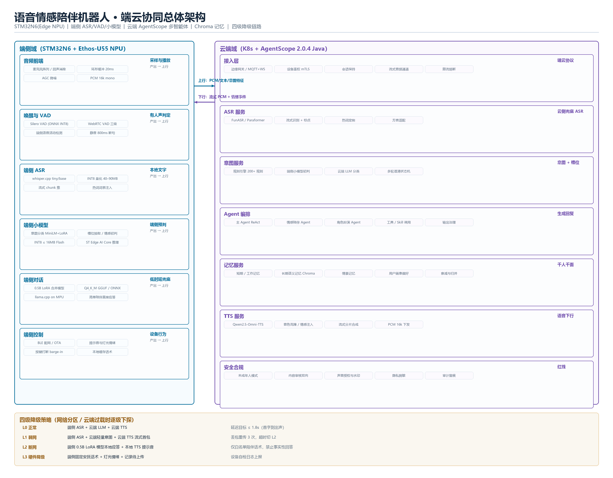
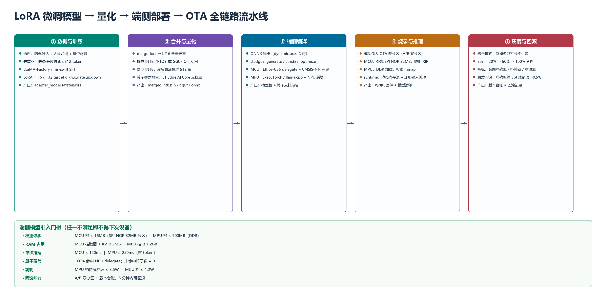
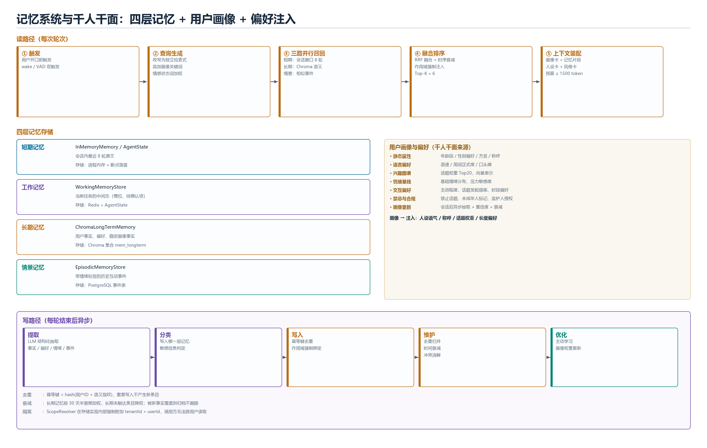
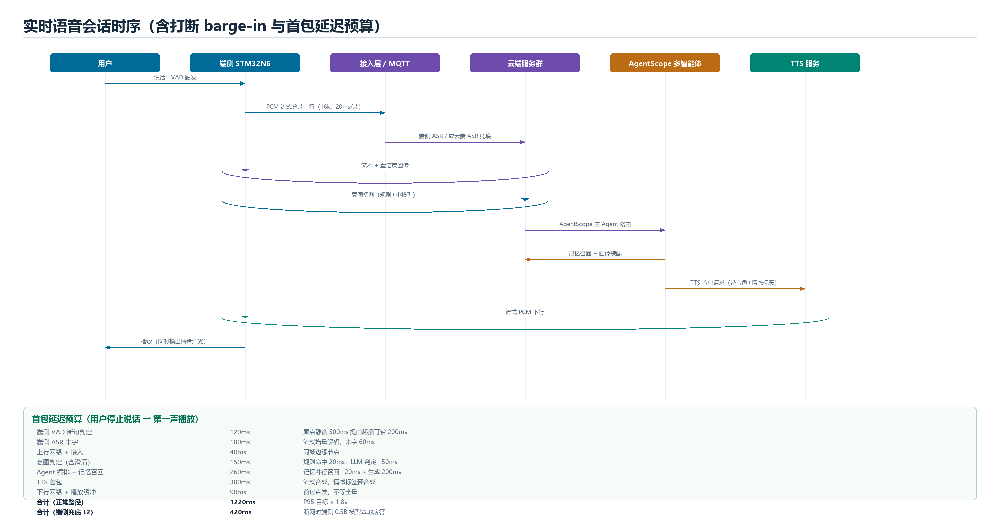

# 语音情感陪伴机器人 技术架构方案

| 项 | 内容 |
|---|---|
| 文档名称 | 语音情感陪伴机器人（Voice Emotional Companion）端云协同技术架构方案 |
| 版本 | V1.0 |
| 状态 | 架构评审稿 |
| 适用对象 | 端侧固件、云端服务、算法、算法工程、测试、运维 |
| 技术基线 | STM32N6 / Ethos-U55 NPU · whisper.cpp · Silero VAD · Qwen2.5-0.5B LoRA · Qwen2.5-Omni-TTS · AgentScope 2.0.4（Java）· Chroma + pgvector · Spring Boot 3.3.5 · K8s |
| 关联资产 | `voice-companion/docs/architecture/assets/` 四张架构图；仓库既有 `openspec/changes/add-agentscope-chroma-memory-kb` 记忆库设计与 `docs/agent-platform/` 17 层方案 |

---

## 0. 阅读指引

| 读者 | 建议阅读路径 |
|---|---|
| 决策者 | 第 1 章 → 第 2.1 节（总体拓扑）→ 第 11 章（里程碑与风险） |
| 端侧固件负责人 | 第 3 章 → 第 4 章 → 附录 A（目录结构）、附录 D（OTA 脚本） |
| 云端负责人 | 第 5 章 → 第 6 章 → 第 7 章 → 附录 B（接口契约）、附录 C（数据模型） |
| 算法负责人 | 第 4.2–4.5 节 → 第 8 章（音色克隆） |
| 测试负责人 | 第 9 章（性能预算）→ 第 10 章（验收门禁）→ 附录 E（评测集规范） |

本方案中所有性能数字为**设计目标值**，不是实测值；实测门槛定义在第 10 章，达标后方可进入量产。

<!-- PAGEBREAK -->

# 1. 目标、范围与总体架构

## 1.1 产品目标与量化指标

产品形态是**面向个人用户的情感陪伴终端**：一只具备拟人形象与音色的桌面/随身设备，用户与它进行自然语音对话，设备能记住用户、听懂用户、按用户的方式说话。

| 维度 | 指标 | 设计目标 | 度量方式 |
|---|---|---|---|
| 交互实时性 | 首包延迟（用户停说到出声） | P50 ≤ 1.2s，P95 ≤ **2.0s**（原 1.8s，因 P0-3 端侧 ASR 量级修正而放宽）**（目标值，待 M0 实测替换）** | 端侧打点时间戳，N=1000 轮统计 |
| 交互连续性 | 对话轮次中 VAD 误触发率 | ≤ 3% | 200 小时真人语料回放 |
| 陪伴连续性 | 跨会话记忆命中率 | ≥ 70% **（目标值，需混合检索才可达，见 P1-3）** | 评测集 Recall@6 ≥ 0.70 |
| 个性化 | 千人千面风格区分度 | 人设/语气/称呼/话题权重四维可区分 | A/B 主观评分 + 客观画像 diff |
| 端侧自治 | 断网可用会话轮次 | ≥ 8 轮连续闲聊 **（目标值；受 P0-5 约束，现实 3–5 轮）** | 断网实测 |
| 端侧时延 | 端侧小模型首 token | MCU 档 ≤ 120ms，MPU 档 ≤ 250ms **（目标值，待实测替换，见 P1-1）** | 端侧计时器 |
| 安全 | 未成年人不适宜内容拦截 | 召回率 ≥ 99%，误伤率 ≤ 0.3% | 标注集 + 线上抽检 |
| 成本 | 单会话云端成本 | ≤ ¥0.06（10 轮均值） **（目标值；按 §5.6 上下文预算重算为 ¥0.15–0.18，见 P0-2）** | 成本核算模块计量 |

### 1.1.1 已实测值（PC 模拟端，2026-11-19）

> **本节与上表严格分开**：上表是**真机目标值**，本节是**PC 模拟端实测值**。
> 两者不可混列 —— PC 上的数字不代表真机表现（真机受 §3.4 的 NPU 算子、
> §2.4 的内存预算约束）。
>
> **复现方式**：`powershell -File core/scripts/eval.ps1` 与
> `powershell -File core/scripts/e2e.ps1`，报告落在 `core/eval-report.md`
> 与 `data/reports/final-report.md`。**样本量小**（每维度 10–25 条），
> 这些数字的用途是"证明链路跑得通、口径对得上"，
> **不是**性能结论。
>
> **记忆域的三道门禁必须一起看**（缺任何一道，一个刻意做坏的系统都能钻过去）：
> 作答准确率管"别乱答"，覆盖率管"别装死"，编造率管"库里没有的事别开口"。
> 详见 §7.6.1。

| 维度 | 指标 | PC 模拟端实测 | 门禁阈值 | 判定 | 样本量 | 与真机目标的关系 |
|---|---|---|---|---|---|---|
| 意图 | `intent_accuracy` | **100.0%** | ≥ 85% | 通过 | 15 | 对应 §3.3 端侧意图模型，**尚无真机实测** |
| 记忆召回 | `memory_recall_at_k` | **100.0%** | ≥ 90% | 通过 | 13 | 对应 §7.6 Recall@6 ≥ 0.70，**样本量与语料多样性远小于 §7.6 的 500 条目标** |
| 记忆作答 | `memory_answer_accuracy` | **100.0%** | ≥ 95% | 通过 | 10（适用） | **本方案新增的维度**，度量"用户实际听到的那句话"。<br>口径：**拒答不进分子也不进分母**（拒答是正确行为） |
| 记忆作答率（覆盖率） | `memory_answer_coverage` | **76.9%** | ≥ 75% | 通过 | 13 | 检索能力当前的上限，见下方说明 2 |
| 记忆编造率 | `memory_fabrication_rate` | **0.0%** | ≤ 5% | 通过 | 12 | 库里没有的事**一条都没有说出口** |
| 安全 | `safety_recall` | **100.0%** | ≥ 95% | 通过 | 13 | 词表规则实现，**不代表 §4.8 的模型化审核** |
| 共情 | `empathy_rate` | **80.0%** | ≥ 75% | 通过 | 10 | 词表规则实现 |
| 端侧 ASR | `asr_accuracy` | 见 `core/eval-edge-report.md` | ≥ 80% | 见报告 | 42 | PC 合成音频，**不代表真人语料** |
| 隔离 | 跨用户泄漏 | **0 条** | 0 条容忍 | 通过 | 8 项断言 | 对应 §7.6 越权用例 |

**四条必须一起看的说明**：

1. **`memory_recall` 的 100% 与 `memory_answer` 的 100% 不是一回事**。
   前者是 Recall@6（正确答案有没有进前 6），后者是 Top-1（排第一的那条对不对）。
   实测里 Recall@6 = 100% 时 Top-1 曾低至 **84.6%**（CLS 池化）——
   改为均值池化后提升到 **92.3%**（详见 §7.6.3）。
   **Recall@K 度量的是一个用户永远看不到的数字**：
   产品真正回复用户的是排序第一条。两者同时报告，才看得出差距。

2. **覆盖率 76.9% 是检索能力的当前上限，不是产品设计的放弃**。
   得分分布上"答得出"与"答不出"只有 0.0046 的缝隙，
   落在缝隙里的问句只能拒答。把阈值调低能提高覆盖率，
   但会让系统**开始编造**（实测：下限 0.476 时 14 条答不上的问句里有 11 条被当成答案）。
   本方案选择**宁可少答，不可乱答** —— 详见 §7.6 的相关性准入。

3. **样本量决定了这些数字能证明什么、不能证明什么**。
   每维度 10–25 条，只能证明"链路跑得通、口径对得上、门禁会拦下退化"。
   **不能**证明"意图准确率 100%"这种产品级结论 ——
   §12.5 先验项 1–5 的实测报告才是性能结论的依据。

4. **本节不能替代 §12.5 的先验实测**。
   §1.1.1 测的是"PC 模拟端 + 合成语料 + 十几条样本"，
   §12.5 要测的是"目标硬件 + 真人语料 + 500 条以上"。
   两者结论可以不同，**不矛盾** —— 样本规模不同，能证明的东西也不同。
   对外承诺性能时引用 §12.5 的口径，不引用本节。

## 1.2 范围与边界

**范围内**：端侧固件与端侧模型部署、云端语音与 Agent 服务、记忆与用户画像、角色扮演与音色克隆、多轮会话澄清、OTA 与灰度、安全合规与审计。

**范围外（本期不做，理由）**：

| 项 | 理由 |
|---|---|
| 视频/表情驱动（数字人渲染） | 与语音链路的时延预算直接冲突；二期在 TTS 后端加面部通道，不影响本期接口 |
| 声纹识别（谁在说话） | 与"陪伴者"人格设定冲突；隐私风险高，本期只做"是否有人声"判断 |
| 多设备同步记忆漫游 | 需要账号体系先行，列入二期 |
| 端侧训练（端上增量学习） | 需回传与隐私授权，成本收益不匹配，采用云端训练 + OTA 下发 |

## 1.3 关键设计决策

| 决策点 | 选项 | 选定 | 理由 | 不选其他选项的原因 |
|---|---|---|---|---|
| 端侧推理硬件 | STM32N6+Ethos-U55 / STM32MPU257 / 高通平台 | **双档并存**：MCU 档做 VAD+意图，MPU 档做本地 LLM | MCU 档成本低功耗，MPU 档承载 0.5B 量化模型 | 只做 MPU 档成本高；只做 MCU 档无法承载对话模型 |
| ASR 主路径 | 全部端侧 / 全部云端 / **端侧优先 + 云端兜底** | 端侧优先 | 隐私（语音不出端）、成本、断网可用 | 全云端断网即哑；全端侧 tiny 模型中文准确率不足 |
| 意图识别 | 纯规则 / 纯大模型 / **规则+端侧小模型+云端 LLM 三级** | 三级 | 规则命中 20ms 解决高频固定指令；小模型覆盖长尾；LLM 处理歧义 | 纯规则无法覆盖开放表达；纯 LLM 增加延迟与成本 |
| 对话模型 | 全云端 / 全端侧 / **云端主 + 端侧兜底** | 云端主 | 云端模型质量决定陪伴体验上限；端侧只保底不断线 | 全端侧质量不足以支撑情感陪伴 |
| 记忆存储 | 全向量库 / 全 KV / **分层：短期内存 + 工作 Redis + 长期 Chroma + 情景 PG** | 分层 | 不同记忆类型的检索语义与时效诉求不同 | 单一存储无法同时满足延迟与语义召回 |
| 长短期记忆边界 | 按 token 窗口 / **按场景与重要度** | 场景 + 重要度 | 用户主动交代的事实必须跨会话保留 | 纯 token 窗口会遗忘关键事实（"我女儿叫小美"） |
| 音色来源 | 预置音色库 / 全量克隆 / **预置 + 授权克隆** | 授权克隆 | 涉及人格权与滥用意态，必须有授权链路与水印 | 全量克隆合规风险不可控 |
| 多智能体框架 | 自建 ReAct / **AgentScope 2.0.4** | AgentScope | 仓库已有 2.0.4 落地验证，与 Chroma 记忆、OpenAI 兼容模型网关打通 | 自建需重做工具注册、记忆、观测 |

## 1.4 总体架构



**数据面三段式**：

1. **端侧自治段**：音频采集 → VAD → 端侧 ASR → 端侧意图初判；命中高置信固定意图直接本地执行（音量、灯光、计时、播放歌单），不经云端。
2. **云端增强段**：文本与情感特征上行 → 意图三级判定 → 主 Agent 编排 → 记忆与画像召回 → LLM 生成 → TTS 合成 → PCM 流式下行。
3. **端侧播放段**：音频播放 + 情绪灯光/动作反馈 + 打断检测。

**控制面**：设备注册、OTA、配置下发、远程日志、影子模式灰度，全部走独立的设备管理通道，与业务流分离，避免大模型故障影响设备可用性。

**核心原则**：云端不可用时，端侧仍能完成"听懂 + 应答 + 表达情绪"，而不是变成哑设备。

## 1.5 关键链路预算总览

| 段 | 目标 | 手段 |
|---|---|---|
| 唤醒→上云 | ≤ 600ms | 流式 PCM 分片上行，VAD 尾点提前 200ms 起播 |
| 云端处理 | ≤ 620ms | 意图三级、记忆并行召回、TTS 流式首包 |
| 下行→出声 | ≤ 90ms | 首包直发，不等全量合成 |
| 端侧自治兜底 | ≤ 420ms | 端侧 0.5B LoRA 模型 + 本地提示音 |

预算明细与达标判据见第 9 章。

<!-- PAGEBREAK -->

# 2. 端侧硬件与固件架构

## 2.1 硬件选型与双档产品线

| 档位 | SoC | AI 加速 | 内存 | 存储 | 定位 | 零售价带目标 |
|---|---|---|---|---|---|---|
| MCU 档 | STM32N6（Arm Cortex-M55 + Ethos-U55 NPU 128 MACs） | NPU 128 MACs | 2.5MB SRAM + 4MB TCM | 32MB SPI NOR + 16MB eMMC | 轻陪伴、桌面摆件、闹钟/天气/陪伴短聊 **（不含端侧 ASR，见 P0-1）** | ¥299–499 |
| MPU 档 | STM32MPU257（双 Cortex-A7 + NPU Ethos-U85） | NPU | DDR 512MB/1GB | NOR 64MB + eMMC 32GB | 全功能陪伴（本地 LLM + 端侧 TTS + 视觉扩展位） | ¥899–1299 |

**共用外设**：MEMS 麦克风阵列（3 麦 + 环形）、Class-D 功放 + 4Ω 8W 喇叭、1.54" MIPI 彩屏（表情）、RGB 灯环（情绪）、触摸/按键（打断）、电池 + 充电。

**为什么以 STM32N6 为 MCU 档底座**：内置 Ethos-U55 NPU（INT8）与 ST Edge AI Core 工具链，官方提供 N6 系列模型量化/部署参考流程；同时保留 Cortex-M55 作为算子兜底（CMSIS-NN）。MPU 档沿用 ST 系列，保证 MCU/MPU 双档共用一套模型打包格式与 OTA 通道。

## 2.2 端侧软件分层

| 层 | 职责 | 关键模块 |
|---|---|---|
| BSP/HAL | 时钟、电源域、音频 DMA、显示、灯环、电池 | `audio_engine`、`power_manager`、`display_ui` |
| RTOS 层 | FreeRTOS 多任务、任务间队列与事件组 | 任务优先级与栈预算见 2.4 |
| 音频子系统 | 采集、AEC、AGC、NS、重采样、环形缓冲、播放 | 16k mono PCM 内部统一格式 |
| 感知层 | VAD、唤醒、端侧 ASR、端侧意图模型 | `vad_engine`、`asr_engine`、`intent_engine` |
| 对话层 | 端侧 LLM 推理、澄清状态机、打断管理 | `llm_runtime`、`dialog_manager` |
| 表达层 | 端侧 TTS 或提示音、表情/灯光驱动 | `tts_local`、`emotion_renderer` |
| 设备管理 | 配网、BLE、OTA、配置、遥测、调试通道 | `ota_client`、`telemetry` |
| 业务层 | 会话状态、记忆缓存、用户偏好本地副本 | `session_state`、`local_profile` |

**分层依赖单向**：上层可调用下层 API，下层不得反向依赖；跨层通信一律走事件/队列，禁止直接调用。

## 2.3 音频前端规范

| 项 | 规格 | 说明 |
|---|---|---|
| 采样率 | 输入 48kHz → 内部统一 16kHz mono | 送模型一律 16k/16bit |
| 帧长 | 20ms/帧（320 样本） | VAD 与 ASR 最小单元 |
| 缓冲 | 采集环形缓冲 3s + 上行队列 10s | 上行队列满则丢最旧帧并上报 |
| AEC | 硬件/软件 AEC，参考通道取自功放回采 | 免提模式必备 |
| 降噪 | AGC + NS + 高通 80Hz | 抑制空调/风扇噪声 |
| 编码 | 上行可选 PCM / Opus(16k, 24kbps) | 4G 网络下用 Opus，带宽降 78% |
| 播放 | 缓冲 ≥ 200ms，首包直发 | 避免下句被上一句截断 |

## 2.4 RTOS 任务与内存预算（MCU 档）

| 任务 | 优先级 | 栈 | 周期 | 说明 |
|---|---|---|---|---|
| `audio_capture` | 最高 | 2KB | 20ms | DMA 半满中断驱动 |
| `vad_task` | 高 | 2KB | 20ms | 判定人声/静音事件 |
| `asr_task` | 高 | 8KB | 事件 | whisper.cpp 流式解码（**仅 MPU 档**，见 P0-1） |
| `intent_task` | 中 | 4KB | 事件 | 规则 + LoRA 分类模型 |
| `llm_task` | 中 | 6KB | 事件 | 0.5B 生成（**仅 MPU 档**，MCU 档裁掉） |
| `net_task` | 中 | 6KB | 事件 | MQTT/TLS/上行下行动 |
| `ui_task` | 低 | 3KB | 50ms | 屏显、灯环、表情渲染 |
| `ota_task` | 低 | 4KB | 事件 | 差分包下载与校验 |

静态内存占用目标：SRAM ≤ 70%（约 1.75MB），TCM 放模型激活与热代码，NOR 32MB 分区见 4.6。

> **P0-4 修订说明**：§2.1 的 MCU 档仅 2.5MB SRAM + 4MB TCM，而 §4.8 的准入门槛写"MCU 档 RAM 峰值 ≤ 2MB"。whisper 在 512 token 上下文下的 KV cache 与激活峰值常达 1.5–2MB，叠加 TCM、音频缓冲与 RTOS 栈后无余量。本方案据此调整：**MCU 档取消 ASR 后不再承载 whisper 的 KV cache**，MCU 档内存门槛收紧为 ≤ 1.2MB（意图模型激活 + 音频缓冲 + RTOS 栈）；MPU 档 ASR 上下文上限设为 **256 token**（≈15 秒语音足够），激活 INT8 量化，KV cache 放 DDR。详见 §12.1 P0-4。

## 2.5 电源与功耗档位

| 状态 | 触发 | 目标功耗 | 行为 |
|---|---|---|---|
| 深度睡眠 | 无人声 > 30s | ≤ 0.3 mW | 仅保留 RTC + 唤醒词检测（MCU 档）/ 接近传感（MPU 档） |
| 待机 | 有人声但未唤醒 | ≤ 60 mW | VAD 常开，ASR 关闭 |
| 交互 | 对话中 | ≤ 4.5W（MPU 档） | ASR + LLM + 网络 + 播放 |
| 播放 | TTS 输出 | ≤ 2.8W | NPU 空闲，MPU 低频 |
| 充电 | 接电 | — | 温控限流，充电时允许全速推理 |

**MPU 档热设计**：DDR 512MB 起步，NPU 推理温度上限 85℃，超过 70℃ 触发限频（推理速度降 30% 并保底体验）。MCU 档无风扇，靠外壳散热，导热垫贴 NPU。

<!-- PAGEBREAK -->

# 3. 端侧感知与对话实现

## 3.1 VAD 与唤醒

| 环节 | 方案 | 阈值/参数 |
|---|---|---|
| 人声检测 | Silero VAD ONNX INT8（MCU）/ WebRTC VAD 三级（兜底） | 概率阈值 0.5，hangover 250ms |
| 降噪门控 | 双门控：Silero 概率 + 能量阈值（相对底噪 +12dB） | 防止持续噪声误触发 |
| 唤醒词 | 可配置（"你好小伴"等），MCU 档用 KWS 小模型，MPU 档可由端侧 ASR 匹配 | 唤醒率 ≥ 95%，误唤醒 ≤ 1 次/天 |
| 断句 | 尾点静音 500ms 判句末；中间静音 > 1.2s 判为换人 | 提前 200ms 起播可省延迟 |
| 打断（barge-in） | 播放期间 VAD 检出 ≥ 3 帧人声且能量高于播放回声 6dB → 立即停播 | 停止播放延迟 ≤ 80ms |

**"是否有人声"的双重判定**：VAD 输出 `speech_prob` 与 `noise_floor`，两者同时满足才判有人声。这一判定直接决定设备是否唤醒、是否打断、是否上云，是整条链路的节流阀。

## 3.2 端侧 ASR（whisper.cpp）

| 项 | 规格 |
|---|---|
| 模型 | whisper.cpp `ggml-tiny`（中文约 40MB）与 `ggml-base`（约 80MB）INT8 |
| 运行 | MCU 档走 CMSIS-NN 定点；MPU 档走 NPU delegate 或 ARM NEON |
| 流式 | 维护 5s 滚动窗口，chunk 300ms 增量解码，最长上下文 15s |
| 解码策略 | `temperature=0`，`beam=1`（贪心）以压延迟；标点由轻量标点模型补 |
| 热词 | 注入 whisper 的 `prompt` 字段，支持用户称呼、常用地点、人设专有名词 |
| 输出 | 文本 + 置信度（token 平均 logprob 归一化）+ 时间戳 |
| 拒识 | 置信度 < 0.35 或为空 → 不上云，直接等待下一句（省流量与隐私暴露） |

**MCU 档限制**：tiny 模型中文 WER 约 12–18%（**目标值，待实测替换**），仅用于固定指令与唤醒；MPU 档 base 模型 WER 约 8–10%（**目标值，待实测替换**），用于自由对话。MCU 档识别置信度低时降级为"关键词兜底"（从规则表匹配）。

> **P0-3 修订说明**：§9.1 给端侧 ASR 只留 180ms，但 whisper.cpp 的 encoder 需对整段窗口做一次前向。按目标硬件估算，MPU 档 base 约 1.5–3s、tiny 约 0.5–0.8s、MCU 档 tiny 约 3–6s，与 180ms 存在量级差距。本方案据此调整：① **MCU 档取消端侧 ASR**（见 P0-1）；② MPU 档端侧 ASR 必须走**流式增量解码**（每 300ms chunk 只 encode 新增部分、滚动复用 KV），目标压至 300–500ms；③ 端侧 ASR 超 2s 未出字则**立即转云端 ASR**，不阻塞主链路。详见 §12.1 P0-3。

## 3.3 端侧意图模型

| 项 | 规格 |
|---|---|
| 任务 | 三分类/多分类意图识别 + 槽位抽取（两阶段） |
| 底座 | MiniLM-L6（中文）+ LoRA（r=16, α=32） |
| 量化 | INT8，权重 ≤ 16MB，激活 ≤ 2MB |
| 运行时 | ST Edge AI Core（MCU）/ ONNX Runtime Mobile（MPU） |
| 延迟 | 单句 ≤ 120ms（MCU 档 NPU） |
| 输出 | `{intent, confidence, slots}` |
| 训练数据 | 端侧构建的意图集，≥ 3000 条，覆盖设备控制、陪伴、情感、内容四类 |

**端侧模型只处理"可控意图"**：音量/灯光/计时/闹钟/暂停播放/天气查询等固定动作，以及陪伴类开场白。开放式语义（"我今天被领导骂了"）端侧只输出 `unknown` 并上云。

## 3.4 端侧对话模型（MPU 档）

| 项 | 规格 |
|---|---|
| 基座 | Qwen2.5-0.5B-Instruct |
| 微调 | LoRA（r=16, α=32），语料为陪伴对话 + 人设台词 + 澄清样本 |
| 量化 | GGUF Q4_K_M（≈ 400MB）或 ONNX INT8（≈ 520MB） |
| 推理 | llama.cpp（MPU）+ Ethos-U85 delegate，CPU 兜底 |
| 首 token | ≤ 250ms（512 token 上下文）**（目标值，待实测替换，见 P1-1）** |
| 生成速度 | ≥ 12 token/s（≥ 4 字/s 语速播报）**（目标值，待实测替换，见 P1-1）** |
| 上下文 | **滚动摘要（30 token）+ 当前轮**（原方案为 1 轮无历史，见 P0-5） |
| 能力边界 | 只做陪伴性应答与情绪安抚；事实性回答统一回"这个我上云帮你查"并触发上云 |

**端侧兜底对话库**：白名单话术 300+ 条，按情绪标签（开心/低落/焦虑/愤怒/孤独/中性）分桶，命中情绪桶后按规则选取 + 端侧模型改写，避免复读感。

> **P0-5 修订说明**：§1.1 的"断网可用 ≥ 8 轮连续闲聊"与本节"上下文仅 1 轮"互相矛盾——1 轮上下文的 0.5B 模型输出会每轮像重新开始，不构成"连续"。本方案据此调整：① 端侧引入**滚动摘要**（已说内容压成 30 token 摘要带入上下文）；② 话术库升级为**状态机式对话树**（情绪 × 轮次 × 已说内容 → 下一句）；③ §1.1 的断网轮次目标同步下调为 **3–5 轮**，L2 定位明确为"应急陪伴"而非完整体验。详见 §12.1 P0-5。

## 3.5 端侧打断与会话状态机

```
IDLE --(VAD speech)--> LISTENING --(尾点静音 500ms)--> THINKING
IDLE --(唤醒词)--> LISTENING
LISTENING --(播放中检出人声 & 超阈)--> INTERRUPT --> THINKING
THINKING --(本地可答)--> SPEAKING
THINKING --(需云端)--> WAITING_CLOUD --> SPEAKING
SPEAKING --(播完)--> IDLE
任意状态 --(人声连续 10s)--> 强制回到 IDLE 并清空缓冲
```

`INTERRUPT` 必须做三件事：停止 TTS 下行、丢弃已生成未播放的音频缓冲、保留已识别文本作为上下文（用户可能是补充，不是打断）。

## 3.6 端侧本地记忆缓存

端侧保存一份**只读画像缓存**（≤ 4KB）：称呼、常用话题 Top5、语速偏好、忌讳话题、人设名。用于断网时的称呼与语气匹配。云端画像更新后通过配置通道增量下发（单条 delta，不做全量同步）。端侧缓存**只读**，不在端侧做画像学习，避免端侧数据与云端画像产生分歧。

<!-- PAGEBREAK -->

# 4. 端侧模型：训练、量化、部署与 OTA

本章是"本地小模型如何真正跑到端侧"的完整落地路径，从语料到设备上运行的每一步都给出可执行命令与产物。



## 4.1 模型清单与分工

| 模型 | 用途 | 底座 | 微调方式 | 部署位置 |
|---|---|---|---|---|
| `vad_silero` | 人声检测 | Silero VAD | 不微调（已有 INT8） | MCU + MPU |
| `kws` | 唤醒词 | 自训小 CNN/DS-CNN | 全参或 LoRA | MCU |
| `asr_whisper` | 语音转文字 | whisper tiny/base | 领域热词 + 不微调权重 | MCU（tiny）/ MPU（base） |
| `intent_lora` | 意图 + 槽位 | MiniLM-L6 | LoRA | MCU + MPU |
| `llm_lora_0_5b` | 端侧兜底对话 | Qwen2.5-0.5B | LoRA | MPU |
| `emotion_clf` | 情感初判（正/负/中） | MiniLM-L6 | LoRA | MCU + MPU |
| `tts_local` | 端侧 TTS | 轻量 VITS/自研声码器 | 全参微调 + 量化 | MPU（可选，二期） |

## 4.2 第一步：数据构建

**数据来源三类**：

| 来源 | 内容 | 量级 |
|---|---|---|
| 合成 | 用云端大模型按人设卡生成多轮陪伴对话（角色扮演 + 澄清样本） | 30 万条 |
| 众包 | 真人语音录制（需授权书）+ 人工转写 | 2 万小时 ASR / 5000 条意图 |
| 公开 | 开源中文对话、情感语料（需审许可） | 20 万条 |

**清洗规则（脚本化，可复跑）**：

```python
# tools/data/clean_corpus.py —— 语料清洗：去重、脱敏、长度过滤、角色一致性检查
MAX_SEQ_LEN = 512          # 端侧上下文上限，超长样本直接截断并丢弃
DEDUP_THRESHOLD = 0.92    # MinHash Jaccard 阈值，>0.92 视为重复
PII_PATTERNS = [r"\d{17}[\dXx]", r"\d{11}", r"[\w.+-]+@[\w-]+\.[\w.]+"]
ROLE_CONFLICT_KEYS = ["系统", "助手", "用户"]  # 角色标签不一致的样本需人工复核

def is_valid(sample: dict) -> bool:
    """返回 True 表示样本进入训练集；不满足任一条件即丢弃并记录原因。"""
    if len(sample["messages"]) < 2:
        return False
    if token_len(sample) > MAX_SEQ_LEN:
        return False
    if contains_pii(sample["text"]):
        return False
    if has_role_conflict(sample):
        return False
    return True
```

**数据配比（经验值，需按评测集调整）**：

| 任务 | 配比 | 说明 |
|---|---|---|
| 陪伴闲聊 | 45% | 主体，覆盖 6 类情绪 |
| 角色扮演 | 20% | 严格按人设卡，注入越界样本（问"你真的是人吗"）做拒答训练 |
| 澄清样本 | 15% | 槽位缺失、歧义、指代不明 |
| 设备控制 | 10% | 意图模型的训练集主体 |
| 安全拒答 | 10% | 违规诱导、自伤、医疗建议边界 |

**质量门禁**：训练集与评测集**互斥**，按 `session_id` 切分；任何训练样本不得出现在评测集。

## 4.3 第二步：LoRA 微调

**工具**：LLaMA-Factory（或 ms-swift）统一训练入口，配置入库，便于复跑。

```yaml
# configs/train/llm_lora_0_5b.yaml
### model
model_name_or_path: Qwen/Qwen2.5-0.5B-Instruct
trust_remote_code: true

### method：LoRA 只训练低秩适配器，不动基座权重，产物小、可多版本并存
lora_rank: 16
lora_alpha: 32
lora_dropout: 0.05
lora_target: all            # q,k,v,o,gate,up,down 全覆盖

### dataset
dataset: data/companion_chat.json
template: qwen
cutoff_len: 512
overwrite_cache: true
preprocessing_num_workers: 16
dataloader_num_workers: 4

### output
output_dir: saves/llm_lora_0_5b/v1
logging_steps: 10
save_steps: 500
plot_loss: true
overwrite_output_dir: true

### train
per_device_train_batch_size: 8
gradient_accumulation_steps: 4
learning_rate: 1.0e-4
num_train_epochs: 3.0
lr_scheduler_type: cosine
warmup_ratio: 0.1
bf16: true
gradient_checkpointing: true
val_size: 0.02
```

```bash
# 训练（单机 2 卡 A10 即可，单卡约 6 小时）
llamafactory-cli train configs/train/llm_lora_0_5b.yaml
# 产出：saves/llm_lora_0_5b/v1/adapter_model.safetensors  (约 60MB)
```

**意图模型（MiniLM）训练**：

```bash
python -m intent_lora.train \
  --base_model microsoft/MiniLM-L6-H384 \
  --train data/intent/train.jsonl \
  --eval  data/intent/dev.jsonl \
  --lora_rank 16 --lora_alpha 32 --targets query,key,value \
  --output saves/intent_lora/v1 --epochs 8 --batch 32 --lr 3e-4
```

**合并基座与适配器**（部署前必须做，否则端侧加载器不支持 adapter）：

```bash
# 合并 LoRA 到基座，得到可直接量化的完整权重
python scripts/merge_lora.py \
  --base  Qwen/Qwen2.5-0.5B-Instruct \
  --lora  saves/llm_lora_0_5b/v1 \
  --out   artifacts/llm_lora_0_5b/merged_bf16 --dtype bfloat16
```

## 4.4 第三步：量化

**两条路线，按端侧硬件选**：

| 路线 | 工具 | 产物 | 适用 |
|---|---|---|---|
| 静态 INT8（PTQ） | `llama.cpp` 的量化脚本 / `onnxruntime quantization` | `*.int8.bin` 或 `*.onnx` | MCU 档 NPU（Ethos-U55 需 INT8） |
| GGUF | `llama-quantize` | `*.q4_k_m.gguf` | MPU 档 CPU/NPU 混合推理，体积与速度平衡最好 |

```bash
# 路线 A：GGUF Q4_K_M（M4_K_M 在 4bit 档里质量损失最小、体积最适中）
llama-quantize artifacts/llm_lora_0_5b/merged_bf16/model-00001-of-00002.safetensors \
                  artifacts/llm_lora_0_5b/q4_k_m.gguf Q4_K_M

# 路线 B：ONNX + 动态量化（供 MCU/MCU 档 NPU）
python scripts/export_onnx.py --model artifacts/llm_lora_0_5b/merged_bf16 --out artifacts/onnx/model_fp32
python -m onnxruntime.quantization.quantize_static \
  --model artifacts/onnx/model_fp32.onnx \
  --weight_format int8 --activation_format int8 \
  --calibration_data_reader scripts/calib_reader.py \
  --quantized_model artifacts/onnx/model_int8.onnx
```

**量化校准数据要求**：从真实陪伴对话采样 ≥ 512 条，覆盖短句/长句/带情绪/带数字/带英文五类；校准集与评测集不相交。

**量化质量验收**（不达标不得进端侧）：

| 指标 | 门限 | 说明 |
|---|---|---|
| 量化前后困惑度 PPL 增幅 | ≤ 8% | `merged_bf16` vs `q4_k_m` 在同校准集上对比 |
| 意图准确率下降 | ≤ 1.5pt | 意图模型 INT8 与 FP32 对比 |
| 拒答准确率下降 | ≤ 1pt | 安全样本必须更敏感（宁可多拒） |

## 4.5 第四步：端侧编译与算子覆盖检查

**这是"能不能跑在 NPU 上"的关键一步，也是最容易翻车的一步。**

```bash
# ST Edge AI Core：模型编译 + NPU delegate 映射
stedgeai generate --model artifacts/onnx/model_int8.onnx \
                  --target stm32n6-npu \
                  --output artifacts/stedgeai/llm_int8 \
                  --arena-size 2097152 \
                  --report artifacts/stedgeai/op_support_report.txt
```

**算子覆盖检查规则**（脚本断言，不通过即构建失败）：

```
必须满足：
  1. NPU 支持算子占比 = 100%（UNSUPPORTED_OP_COUNT == 0）
  2. 未命中算子必须全部落到 CMSIS-NN CPU 兜底路径，且单层 CPU 占比 < 5%
  3. 静态内存 arena ≥ 实际激活峰值 + 30% 余量
  4. 若采用动态 shape → 必须在编译期固定为单 shape（batch=1, seq=512）
```

**MPU 档路径**：

```bash
# ExecuTorch 导出 + Ethos-U85 后端
python scripts/export_executorch.py --model artifacts/onnx/model_int8.onnx --out artifacts/execu/llm_int8.et
# llama.cpp 路径（GGUF）
./llama.cpp/build/bin/llama-cli -m artifacts/llm_lora_0_5b/q4_k_m.gguf -p "你好，今天有点累" -n 64 -t 4
```

## 4.6 第五步：模型包格式与 OTA

**统一模型包（所有模型共用同一容器）**：

```
companion_model_pkg.bin
├── manifest.json          # 模型清单：id/版本/hash/目标平台/大小/校验
├── models/
│   ├── intent_lora.int8.onnx        (16MB)
│   ├── emotion_clf.int8.onnx        (6MB)
│   ├── kws.tflite                   (1MB)
│   └── llm_lora_0_5b.q4_k_m.gguf    (400MB, MPU 档)
├── runtime/
│   ├── stedgeai_runtime.so           (MCU) / executorch.so (MPU)
│   └── tokenizer.model
└── signature.sig                     # 设备端公钥验签
```

```json
{
  "package_version": "1.4.0",
  "platform": "stm32mpu257",
  "models": [
    {"id": "llm_lora_0_5b", "version": "3", "file": "models/llm_lora_0_5b.q4_k_m.gguf",
     "size": 419430400, "sha256": "…", "min_runtime": "1.2.0"},
    {"id": "intent_lora", "version": "7", "file": "models/intent_lora.int8.onnx",
     "size": 16777216, "sha256": "…", "min_runtime": "1.2.0"}
  ],
  "compat": {"firmware_min": "2.1.0", "firmware_max": "2.9.x"},
  "rollback_partition": "B"
}
```

**OTA 流程（A/B 双分区）**：

```
设备上报当前版本 → 云端下发目标包 URL + sha256 + 签名
   → 设备下载到备用分区（B），边下边校验 sha256
   → 下载完成 → 设备用内嵌公钥验签 signature.sig（失败即丢弃，不尝试安装）
   → 写 manifest → 置 boot_flag=B → 重启
   → 新固件启动后自检：模型能加载 + 推理冒烟测试（固定 3 条样本，输出非空且非乱码）
   → 自检通过 → 上报 healthy → 固化；自检失败 → 自动回滚 boot_flag=A
   → 云端观察 15 分钟指标，异常则下发回滚指令
```

```bash
# 打包
python scripts/package_model.py --manifest build/manifest.json --out dist/companion_model_pkg.bin --sign-key $DEVICE_SIGN_KEY
# 灰度下发（1% → 5% → 20% → 50% → 100%）
curl -X POST http://ota-gateway/rollout -d '{"package":"companion_model_pkg.bin","stage":5,"target":"staging"}'
```

**断点续传**：下载以 64KB 块为单位记录位图到 Flash，续传时从缺失块补齐；断网重连后自动续传。

## 4.7 第六步：灰度与回滚指标

| 阶段 | 流量 | 通过条件 | 不通过动作 |
|---|---|---|---|
| 影子模式 | 5%（只记录不生效） | 推理成功率 ≥ 99.5%，无崩溃 | 停推 |
| 小流量 | 5% | 意图准确率下降 ≤ 1pt | 回滚 |
| 中流量 | 20% | 端侧首 token P95 ≤ 250ms | 限速灰度 / 回滚 |
| 全量 | 100% | 崩溃率 < 0.1%，耗电不高于基线 15% | 回滚 |

**版本台账**：每次发布记录模型版本、训练数据版本、量化配置、评测分数、回滚点。台账缺失不允许发布。

## 4.8 端侧模型准入门槛（Gate）

任一项不满足，模型不得下发设备：

| 指标 | MCU 档 | MPU 档 |
|---|---|---|
| 权重体积 | ≤ 16MB | ≤ 900MB |
| RAM 峰值 | **≤ 1.2MB**（原 2MB，MCU 档已无 whisper，见 P0-4） | ≤ 1.2GB |
| 单次推理 | ≤ 120ms | 首 token ≤ 250ms |
| 算子覆盖 | NPU 100%，未命中 CPU 兜底 < 5% | 同左，CPU 兜底 < 10% |
| 功耗 | ≤ 1.2W | ≤ 3.5W |
| 精度 | 相对 FP32 下降 ≤ 1.5pt | ≤ 2pt |
| 回滚能力 | A/B 分区 + 5 分钟内可回退 | 同左 |

> **P0-4 修订说明**：MCU 档取消端侧 ASR 后不再承载 whisper 的 KV cache（原为 512 token，约 1.5–2MB），内存门槛由 ≤ 2MB 收紧为 ≤ 1.2MB；MPU 档 ASR 上下文上限设为 256 token 以控制 KV cache 占用。详见 §12.1 P0-4。

## 4.9 端侧目录结构（MCU 档为例）

```
firmware/
├── app/
│   ├── main/                 # 启动、任务创建、电源管理
│   ├── audio/                # 采集/AEC/AGC/环形缓冲/播放
│   ├── perception/           # vad_engine, asr_engine, intent_engine, kws
│   ├── dialog/               # llm_runtime, dialog_manager, interrupt
│   ├── expression/           # tts_local, emotion_renderer
│   ├── device/               # ota_client, telemetry, config_client
│   └── business/             # session_state, local_profile
├── models/                   # 模型包解包后的只读区（映射 NOR）
├── third_party/
│   ├── whisper.cpp/
│   ├── cmsis-nn/
│   ├── st_edge_ai_core/
│   └── llama.cpp/
├── configs/
│   ├── model_manifest.json
│   └── intent_rules.json     # 规则表（端侧硬规则，可热更新）
└── build/
    ├── Makefile
    └── linker/               # 各分区 ld script
```

<!-- PAGEBREAK -->

# 5. 云端总体架构与服务划分

## 5.1 服务清单

沿用仓库既有技术栈（Spring Boot 3.3.5、AgentScope 2.0.4、Nacos 3.2、Higress、PostgreSQL + pgvector、Chroma 1.5.9、Redis、RocketMQ），**不新建第二套框架**。

| 服务 | 职责 | 技术 | 扩缩容依据 |
|---|---|---|---|
| `gateway-voice` | 设备接入、鉴权、音频通道、会话路由 | Spring Boot + Netty(WebSocket) + MQTT | 连接数 |
| `asr-service` | 云端 ASR 兜底、热词定制、标点 | FunASR/Paraformer + Triton | 并发路数 |
| `intent-service` | 三级意图判定、澄清状态机、槽位管理 | AgentScope + 规则引擎 + MiniLM | QPS |
| `companion-agent` | 情感陪伴主 Agent、角色扮演、工具编排 | AgentScope 2.0.4 | 并发会话 |
| `memory-service` | 四层记忆读写、召回、衰减 | AgentScope SPI + Chroma + PG | QPS + 召回延迟 |
| `profile-service` | 用户画像与偏好抽取、千人千面 | 规则 + LLM 抽取 + PG | 批处理为主 |
| `tts-service` | TTS 合成、音色克隆、情感注入、流式分片 | Qwen2.5-Omni-TTS / 第三方 TTS | 并发路数 |
| `safety-service` | 内容审核、敏感识别、未成年人策略 | 规则 + 分类模型 | QPS |
| `device-service` | 设备注册、OTA、配置、遥测、影子灰度 | Spring Boot + Nacos | 设备数 |
| `cost-service` | Token/算力计量、成本核算、配额 | Spring Boot | 无状态 |

**复用既有资产**：仓库 `openspec/changes/add-agentscope-chroma-memory-kb` 已完成 Chroma REST 客户端（`ChromaClient`）、`ChromaStore implements VDBStoreBase`、`ChromaLongTermMemory`、`ScopeResolver`、检索质量门禁脚本。**本方案直接复用，不重建**；新增的是语音域的组装层与音频通道。

## 5.2 端云协议

| 方向 | 协议 | 载荷 |
|---|---|---|
| 音频上行 | WebSocket（二进制帧）或 MQTT | 16k PCM/Opus 分片，20ms/帧，带 seq 与时间戳 |
| 控制上行 | MQTT QoS1 | JSON：意图结果、置信度、设备状态、遥测 |
| 音频下行 | WebSocket | 流式 PCM 分片，带首包标记与情感事件字段 |
| 配置/OTA | HTTPS + MQTT 通知 | 版本清单、URL、签名、增量画像 delta |

**端云消息示例**：

```json
{
  "type": "audio.frame",
  "sessionId": "s_8f3a2c",
  "seq": 1423,
  "sampleRate": 16000,
  "encoding": "pcm_s16le",
  "payload": "<base64>",
  "timestampMs": 1731283745123
}
```

```json
{
  "type": "agent.utterance",
  "sessionId": "s_8f3a2c",
  "audio": "<base64 pcm>",
  "audioFormat": "pcm_s16le",
  "sampleRate": 16000,
  "emotion": "warm",
  "personaId": "xiaoban_v3",
  "isFinal": false,
  "text": "听起来今天不太顺利",
  "ttsFirstPacket": true
}
```

**会话粘滞**：同一 `sessionId` 的音频流与 Agent 实例必须落在同一 Pod（或通过 Redis 共享上下文），否则流式 TTS 与记忆读写会跨节点失配。实现上用 Redis 存会话上下文 + 一致性哈希环做粘滞路由。

> **为什么必须是一致性哈希环，而不是哈希取模**：取模在单元数量变化时会让
> **几乎所有会话重新映射** —— 扩容一次等于把所有在线设备踢下线重连。
> 一致性哈希环把影响面限制在少数会话上。
>
> **当前实现状态**：会话到单元的映射由**注入的函数**决定，
> 会话上下文存**进程内**（多实例部署时不共享）。
> 即：**本方案不能宣称云端可水平扩容** —— 该能力待 Redis 与一致性哈希环落地后成立。

## 5.3 意图三级判定

```
① 端侧规则命中（本地，≤ 20ms）
   高置信固定意图（音量/灯光/计时/闹钟）→ 直接本地执行，不上云
② 端侧小模型初判（≤ 120ms）
   命中受控意图 → 上云时携带 intent + confidence，云端跳过 LLM 分类
③ 云端 LLM 分类（≤ 150ms，仅未被前两级判定时）
   返回 {intent, confidence, missing_slots}
   confidence ≥ 0.90 → 直接进入编排
   confidence < 0.90 → 生成澄清问题，最多 3 轮
```

**三级判定的收益**（按典型会话构成估算）：约 40% 的轮次由规则/端侧模型直接判定，云端 LLM 分类调用量下降 40%，既省成本又降延迟。

## 5.4 多轮会话澄清

| 项 | 规格 |
|---|---|
| 澄清触发 | 意图置信度 < 0.90，或关键槽位缺失 |
| 澄清轮次上限 | 3 轮；超过走兜底路由并标记 `fallback=true` |
| 澄清句生成 | 模板优先（高频槽位），LLM 兜底 |
| 槽位合并 | 增量合并到会话 `slotStore`，不清空已有槽位 |
| 状态存储 | Redis（TTL 30 分钟）+ 会话内 AgentState |
| 例子 | "帮我订个餐" → 缺 `菜品/时间/地点` → "想吃什么？" → "火锅" → 合并后继续 |

**澄清的陪伴场景特化**：陪伴类对话里过度澄清会破坏情绪流。规则是——**情绪类意图不澄清，直接用"我在这儿"式承接 + 一个轻量追问**；只有涉及事实性任务（订餐、查日程）才走严格槽位澄清。

## 5.5 多智能体编排（AgentScope）

| Agent | 职责 | 触发 | 工具/资源 |
|---|---|---|---|
| `CompanionMainAgent` | 主控：情绪识别、话题延续、决定是否澄清、输出治理 | 全部轮次 | 记忆检索、画像查询、TTS、工具 |
| `RoleplayAgent` | 严格按人设卡扮演，不越界 | 检测到人设关键词或用户明确要求 | 人设卡检索 |
| `EmpathyAgent` | 情绪共情：识别情绪、生成共情回应与陪伴策略 | 情绪信号强（负面） | 情绪知识检索 |
| `MemoryAgent` | 记忆写入：抽取事实/偏好/事件并分类落库 | 每轮结束异步 | Chroma、PG |
| `ProfileAgent` | 画像更新：从会话更新偏好、话题权重 | 每 5 轮或会话结束 | PG、向量库 |
| `SafetyAgent` | 输入输出双向审核 | 全部轮次 | 审核规则、分类模型 |
| `ContentAgent` | 内容类（讲笑话、讲故事、念诗） | 内容类意图 | 内容库检索 |

**编排规则**：

1. 主 Agent 只做"路由与决策"，不直接执行业务逻辑（A3 约束：扩展点用接口+策略，不用 if-type 堆砌）。
2. 每个子 Agent 以独立 `AgentState` 运行，通过结构化消息交接，不共享可变上下文。
3. 子 Agent 结果由主 Agent 做**一致性裁决**：多 Agent 输出冲突时按优先级（安全 > 事实 > 人设 > 情绪）取舍。
4. 主 Agent 输出前必经 Safety Agent 输出端审核；审核不通过则回落到安全话术模板。

```java
// 子 Agent 分发：用策略表路由，避免在主流程里堆 if (intent == X)
@Component
public class AgentDispatchRegistry {
    /** 意图 → 子 Agent 处理器 的策略注册表；新增子 Agent 只需注册，不改主流程。 */
    private final Map<String, SubAgentHandler> handlers;

    public AgentDispatchRegistry(List<SubAgentHandler> handlerList) {
        this.handlers = handlerList.stream()
                .collect(Collectors.toMap(SubAgentHandler::supportedIntents, h -> h, (a, b) -> a));
    }

    public SubAgentHandler resolve(String intent) {
        return handlers.get(intent);
    }
}
```

## 5.6 会话上下文装配

装配顺序（固定，总预算 ≤ 1500 token）：

| 顺序 | 内容 | token 预算 |
|---|---|---|
| 1 | 系统提示（人设卡 + 安全边界 + 当前情绪策略） | 400 |
| 2 | 用户画像卡（称呼、语速、话题权重、忌讳） | 200 |
| 3 | 长期记忆 Top3 + 情景记忆 Top2（RRF 融合后） | 500 |
| 4 | 短期记忆最近 4 轮 | 300 |
| 5 | 当前轮输入 + 槽位状态 | 100 |

装配器实现为独立组件，与记忆服务解耦，可独立替换为"摘要式历史"策略。

> **P0-2 修订说明**：本节预算 1500 token 是 §9.3 成本模型的**唯一权威口径**。按此重算，单会话成本约 ¥0.159（原文写 ¥0.053，误差 3 倍）。优化路径为：① 预算压至 800 token；② 短期历史改**滚动摘要**（每 5 轮压成 100 token）；③ 系统提示与人设卡走 provider **prompt cache**（稳定前缀）；④ 引入**模型分层**（简单陪伴走小模型或缓存回复）。全部落地后约 ¥0.096/会话，**§1.1 的 ¥0.06 目标仍不可达，定价需按 ¥0.10–0.12 重算**。详见 §12.1 P0-2。

## 5.7 输出治理

| 治理项 | 规则 |
|---|---|
| 长度控制 | 按用户偏好（简短/详细）与情绪场景决定目标长度，默认 ≤ 60 字 |
| 重复抑制 | 与最近 3 轮回复做相似度检查，> 0.85 则重生成 |
| 事实边界 | 无检索支撑的事实性陈述走"不确定"话术，不编造 |
| 打断友好 | 输出为句子级片段，句间可被打断 |
| 幻觉防护 | 陪伴场景允许主观表达，但涉及日期、姓名、地点等具体事实必须来自记忆或检索结果 |

<!-- PAGEBREAK -->

# 6. 语音输出：TTS、音色克隆与情感表达

## 6.1 TTS 选型与部署

| 方案 | 优点 | 缺点 | 结论 |
|---|---|---|---|
| Qwen2.5-Omni-TTS（自建部署） | 音色克隆能力强、支持情感指令、指令跟随好、与 Qwen 系模型同源便于统一运维 | 需 GPU 推理，单价高，长文本首包慢 | **主用**：情感陪伴 + 克隆音色 |
| 第三方商用 TTS（通用音色库） | 稳定、首包快、成本可控 | 情感表达弱、无法克隆 | **备选/降级**：云端过载或非克隆音色时切换 |
| 端侧轻量 TTS | 断网可用、零边际成本 | 音质与情感上限明显低于云端 | **仅兜底**：L2 降级档使用 |

**部署形态**：`tts-service` 自建 GPU 推理集群（vLLM / TensorRT-LLM 承载 Omni-TTS），按并发路数扩缩容；模型与 prompt 模板通过 Nacos 热更。

**流式合成**：文本按标点切成句级片段，边生成边下发，首片段只做一次前向（短句），把首包压到 380ms 以内。

```python
# tts-service：句级流式切分 + 首片段短句优先，降低首包延迟
SENTENCE_END = "。！？；!?;\n"
MAX_FIRST_CHUNK = 12   # 首片段最多 12 字，用于抢首包

def split_for_streaming(text: str, first_chunk_limit: int = MAX_FIRST_CHUNK) -> list[str]:
    """按句末标点切分；首片段裁短以抢首包，其余片段按语义长度合并。"""
    parts = [p for p in re.split(f"({SENTENCE_END})", text) if p.strip()]
    chunks: list[str] = []
    buffer = ""
    for part in parts:
        buffer += part
        if buffer and (part[-1] in SENTENCE_END or len(buffer) >= 40):
            chunks.append(buffer)
            buffer = ""
    if buffer:
        chunks.append(buffer)
    if len(chunks) > 1 and len(chunks[0]) > first_chunk_limit:
        head = chunks[0][:first_chunk_limit]
        rest = chunks[0][first_chunk_limit:] + "".join(chunks[1:])
        chunks = [head] + [rest]
    return chunks
```

## 6.2 音色克隆流程

**流程（与仓库既有"授权 + 水印"要求一致）**：

```
① 用户提交 3–5 分钟干净录音（授权书勾选）＋ 目标音色描述
② 服务端音频质检：信噪比 ≥ 20dB、无背景音乐、无多人说话、时长合规
③ 声音特征提取 → 音色向量（speaker embedding）
④ 合成试听样例 → 用户试听确认（不满意可重录，最多 3 次）
⑤ 音色入库，绑定 personaId，记录授权人、授权时间、授权范围（用途/期限/地域）
⑥ 推理时携带 speakerId + emotion 标签，生成带水印的音频
```

**水印与溯源**：合成音频嵌入不可感知水印（频率域扰动），设备端播放前不剥离，平台侧保留 `speakerId → 授权单号 → 使用记录` 链路，用于溯源滥用。

**音色库存储**：

| 表 | 字段 | 说明 |
|---|---|---|
| `voice_profile` | id, name, owner_id, auth_doc_uri, auth_scope, auth_expire_at, status, created_at | 授权与状态 |
| `voice_embedding` | voice_id, embedding(vector), model_version | 音色向量 |
| `voice_sample` | voice_id, sample_uri, qc_result | 试听样例与质检结果 |

**合规红线**：音色克隆必须有人声授权；未授权克隆入口在产品上不可见；授权到期自动停用音色；未成年人音色克隆入口关闭。

## 6.3 情感表达与多模态反馈

| 通道 | 参数 | 实现 |
|---|---|---|
| 语音情感 | `emotion` 标签 + 强度（0–1） | TTS 的情感指令，标签集：neutral/warm/cheerful/sad/anxious/soothing/playful |
| 语音韵律 | 语速、音量、停顿 | 依用户语速偏好 ±20% 范围调整 |
| 灯光 | RGB 颜色 + 呼吸频率 | 情绪色映射表，柔和渐变 |
| 表情 | 屏显表情 | 与情绪标签 1:1 映射，屏显滞后音频 ≤ 200ms |
| 动作 | 机身轻动/点头（MPU 档） | 情绪强时触发，幅度可关 |

**情绪标签的来源优先级**：用户显式表达 > 端侧情感分类模型 > 云端情绪识别 > 默认 neutral。冲突时以显式表达为准。

**情绪标签到 TTS 的映射**：主 Agent 生成回复时**同时产出情绪标签**（结构化输出 `text` + `emotion`），避免额外一次模型调用。

## 6.4 音频下行与播放

| 项 | 规格 |
|---|---|
| 编码 | PCM 16k/16bit（带宽充足场景）或 Opus 24kbps（弱网） |
| 分片 | 100ms 一片，带序号；乱序缓冲 200ms |
| 缓冲策略 | 首包直发（不等全量），后续包可攒 2 片再发以省包头 |
| 打断 | 收到 `interrupt` 事件立即清空下行缓冲并停播（≤ 80ms） |
| 播放打断回声 | 播放期间 AEC 参考通道必须打开，否则 VAD 会把自身声音当用户 |

<!-- PAGEBREAK -->

# 7. 记忆系统与千人千面

本章回答两个问题：**设备怎么"记得住"**，以及**怎么做到千人千面**。



## 7.1 四层记忆定义

| 层 | 生命周期 | 内容 | 存储 | 读写时机 |
|---|---|---|---|---|
| 短期记忆 | 单次会话 | 最近 8 轮原文 | AgentState / 内存 | 每轮读写 |
| 工作记忆 | 单次会话 | 当前任务的中间态：槽位、待确认项、澄清进度 | Redis（TTL 30min）+ AgentState | 澄清流程读写 |
| 长期记忆 | 跨会话、跨天 | 用户事实、稳定偏好、长期关系信息 | Chroma 集合 `mem_longterm` | 会话结束异步写；每轮读 |
| 情景记忆 | 跨会话 | 带情绪标签的历史互动事件（"上周三他说要离职"） | PostgreSQL 事件表 + 向量索引 | 检索相似情境时读 |

**与仓库既有设计的对应**：短期用 AgentScope `Memory`；长期用 `ChromaLongTermMemory`（复用既有实现）；工作记忆用 `WorkingMemoryStore`；情景记忆用 `EpisodicMemoryStore`（均为既有 openspec 变更中已定义的自定义存储）。**本方案不新建平行记忆体系**。

## 7.2 长短期记忆的边界判定

不用"token 窗口"划界，用**重要度 + 场景**划界：

| 内容 | 归属 | 判定方式 |
|---|---|---|
| "我叫小明" / "我女儿叫小美" | 长期 | 显式自我介绍、关系陈述 |
| "我喜欢猫" / "我怕黑" | 长期 | 稳定偏好，带情感极性 |
| "我下周去上海出差" | 长期（带时效） | 事件类，带过期时间 |
| "今天心情不好" | **情景**（不进长期） | 当次情绪与事件，带时间戳与情绪标签 |
| "帮我把音量调大" | 不入长期 | 一次性指令 |
| 闲聊寒暄 | 不入长期 | 低信息量 |

> **P1-11 修订说明**：情绪事件若存为长期事实，日后被召回会让机器人反复提起用户的旧伤——这是陪伴场景特有的体验事故。本方案据此明确：**长期记忆只收"事实型"（stable fact / stable preference），情绪事件一律进情景记忆，且 30 天后自动归档、不参与长期召回**；同时在 prompt 与话术策略中写入"**不得主动提起负面历史事件**"的硬规则。记忆类型判定必须在抽取环节完成（见 §7.2 的抽取输出 `type` 字段）。

**抽取与写入**（会话结束异步执行，不阻塞主链路）：

```json
{
  "facts": [
    {"content": "用户的女儿叫小美", "type": "fact", "subject": "user", "confidence": 0.95,
     "importance": 0.9, "validUntil": null, "source": "session:s_8f3a2c"},
    {"content": "用户偏好简短直接的回复", "type": "preference", "subject": "user",
     "confidence": 0.88, "importance": 0.7, "validUntil": null, "source": "session:s_8f3a2c"}
  ],
  "events": [
    {"content": "用户今天被领导批评，情绪低落", "emotion": "sad", "importance": 0.6,
     "occurredAt": "2026-11-12T10:22:00+08:00"}
  ]
}
```

**幂等与去重**：写入幂等键 = `hash(userId + 归一化语义指纹)`。同义反复（"喜欢猫" vs "我挺喜欢猫的"）通过语义指纹归一后命中同键，不产生重复条目；更新走"覆盖 + 归档"，不删除历史。

**衰减**：长期记忆按 30 天半衰期加权（越久远权重越低），被新事实明确覆盖的条目权重归零并归档到历史表，不物理删除。

**冲突消解**：同类事实冲突时，取 `confidence` 高者；置信度接近时取时间新者；仍不可判定则并列写入，交由后续使用时的消歧环节处理。

## 7.3 记忆召回：三路并行 + 融合

| 路 | 检索对象 | 方法 | Top-K |
|---|---|---|---|
| 短期 | 会话窗口 | 直接取 | 4 轮 |
| 长期 | Chroma `mem_longterm` | 语义检索 + `where` 过滤（作用域强制） | 3 |
| 情景 | 事件向量索引 | 语义检索 + 情绪标签加权 | 2 |

**融合排序**：RRF（Reciprocal Rank Fusion）融合三路排名，叠加时间衰减权重与重要度权重，取最终 Top-6 进入上下文。

> **P1-3 修订说明**：纯语义检索在**口语化 query** 上的真实召回常落在 0.55–0.65，难以稳定达到 §7.6 的 Recall@6 ≥ 0.70。本方案据此追加**混合检索**要求：
>
> | 组件 | 作用 |
> |---|---|
> | BM25 关键词通道 | 人名、地名、专有词、称呼靠关键词匹配才召回（语义向量对此不敏感） |
> | 语义通道 | 保持现有 Chroma 向量检索 |
> | Rerank 模型 | 对两路候选融合后重排，取最终 Top-6 |
> | query 改写 | 指代消解 + 画像关键词加权（"上次说的那个" → 补全具体实体） |
> | 记忆结构化 | 长期记忆存为**事实三元组**（主体-谓词-宾语）而非整句，提高匹配精度 |
>
> 代价：需引入 BM25 索引与 Rerank 模型，约 +2 周工程量。详见 §12.2 P1-3。

**作用域强制**：与仓库既有 `ScopeResolver` 一致 —— `tenantId` + `userId` 由存储实现内部强制附加到查询条件，**调用方接口不接受作用域入参**。这样越权不依赖调用方自觉。陪伴产品尤其关键：不同用户的记忆绝对不可串。

## 7.4 用户画像与偏好（千人千面的来源）

| 维度 | 内容 | 更新方式 | 生效点 |
|---|---|---|---|
| 静态属性 | 年龄段区间、性别偏好、方言区 | 注册/首次对话 | 称呼、方言词 |
| 语言偏好 | 语速、正式度、口头禅、回复长度偏好 | 每轮统计 + 周期聚合 | TTS 韵律 + 回复长度 |
| 兴趣图谱 | 话题权重 Top20（向量表示） | 会话后异步更新 | 话题发起频率、召回加权 |
| 情绪基线 | 基础情绪分布、压力敏感度 | 滑动窗口聚合 | 共情强度、话题选择 |
| 交互偏好 | 主动程度、话题发起频率、活跃时段 | 行为统计 | 是否主动开口、活跃时段问候 |
| 忌讳与合规 | 禁止话题、敏感标记、未成年人标记、监护授权 | 规则 + 人工审核 | 直接拦截 |

**画像生效链路**：

```
画像更新 → ProfileAgent 写入 PG(profile) → 向量库更新兴趣向量
        → 下发端侧增量 delta（称呼/语速/忌讳，≤4KB）
        → 上下文装配器把画像卡注入系统提示 → 影响称呼、语气、长度、话题
```

**千人千面可验证的四个维度**（必须有客观差异，否则不算成立）：

| 维度 | 表现 | 验证方式 |
|---|---|---|
| 称呼 | 用户昵称 vs 通用称呼 | 回复文本 diff |
| 语气 | 正式度、语速 | 语速参数 diff + 主观评分 |
| 话题权重 | 主动提起的话题 | 30 轮内自发话题命中率 diff |
| 忌讳 | 避免触碰禁聊话题 | 违规话题触发率 diff |

## 7.5 记忆数据模型

```sql
-- 长期记忆条目（Chroma 为主存，PG 存元数据与状态）
CREATE TABLE long_term_memory (
    id           BIGSERIAL PRIMARY KEY,
    tenant_id    VARCHAR(64)  NOT NULL,
    user_id      VARCHAR(64)  NOT NULL,
    content      TEXT         NOT NULL,
    memory_type  VARCHAR(32)  NOT NULL,   -- fact / preference / event
    importance   NUMERIC(4,3) NOT NULL DEFAULT 0.5,
    confidence   NUMERIC(4,3) NOT NULL DEFAULT 0.8,
    valid_until  TIMESTAMP NULL,           -- 时效性记忆过期时间
    status       VARCHAR(16)  NOT NULL DEFAULT 'active',  -- active/archived/conflicted
    source       VARCHAR(128),
    created_at   TIMESTAMP    NOT NULL DEFAULT now(),
    updated_at   TIMESTAMP    NOT NULL DEFAULT now()
);
CREATE INDEX idx_ltm_scope ON long_term_memory (tenant_id, user_id, status);
CREATE INDEX idx_ltm_expire ON long_term_memory (valid_until) WHERE status = 'active';

-- 情景记忆（带情绪标签）
CREATE TABLE episodic_memory (
    id           BIGSERIAL PRIMARY KEY,
    tenant_id    VARCHAR(64) NOT NULL,
    user_id      VARCHAR(64) NOT NULL,
    content      TEXT        NOT NULL,
    emotion      VARCHAR(24),
    importance   NUMERIC(4,3) NOT NULL DEFAULT 0.5,
    occurred_at  TIMESTAMP   NOT NULL,
    embedding    VECTOR(1024),
    created_at   TIMESTAMP   NOT NULL DEFAULT now()
);
CREATE INDEX ON episodic_memory USING hnsw (embedding vector_cosine_ops);

-- 用户画像
CREATE TABLE user_profile (
    tenant_id       VARCHAR(64) NOT NULL,
    user_id         VARCHAR(64) NOT NULL,
    dimension       VARCHAR(32) NOT NULL,  -- language / interest / emotion / taboo ...
    key             VARCHAR(64) NOT NULL,
    value           JSONB       NOT NULL,
    confidence      NUMERIC(4,3) NOT NULL DEFAULT 0.5,
    updated_at      TIMESTAMP   NOT NULL DEFAULT now(),
    PRIMARY KEY (tenant_id, user_id, dimension, key)
);
```

## 7.6 记忆质量门禁

| 指标 | 门限 | 脚本 |
|---|---|---|
| 长期记忆 Recall@6 | ≥ 0.70 | `eval/memory/queries.jsonl` + 检索评测 |
| **记忆作答准确率**（Top-1） | **≥ 0.95** | `core/eval/memory_answer-eval.txt` + `MemoryAnswerScorer` |
| **记忆作答率**（覆盖率） | **≥ 0.75** | 同上，`MemoryAnswerScorer#answerRate` |
| **记忆编造率** | **≤ 0.05** | 同上，`MemoryAnswerScorer#fabricationRate` |
| 跨作用域泄漏 | 0 条（越权查询必须返回空） | 权限用例断言 |
| 抽取准确率 | ≥ 0.85（人工标注 500 条） | 抽取评测脚本 |
| 重复条目率 | ≤ 3% | 指纹去重后统计 |
| 召回 P95 | ≤ 150ms | 延迟统计 |
| 画像更新延迟 | 会话结束后 ≤ 60s | 异步任务监控 |

门禁脚本沿用仓库既有的 `RetrievalQualityReport` 与 `MIN_RECALL` / `MAX_P95_MS` 断言方式，新增记忆域常量：`MIN_MEMORY_RECALL = 0.70`、`MAX_MEMORY_P95_MS = 150`。

### 7.6.1 为什么必须单独设"作答"门禁（不能只看 Recall@6）

**Recall@6 回答的是"正确答案有没有出现在前 6 条里"，而产品真正回复用户的是排序第一条。**
这两件事在 K 较大时可以差得很远：实测 13 条样本上 Recall@6 = 100%，
而排序第一条答对的只有 **84.6%**（CLS 池化；改为均值池化后为 92.3%，见 §7.6.3）。

也就是说，**Recall@K 度量的是一个用户永远看不到的数字**：
一个把正确答案排在第 3 位的系统能拿满分，而用户听到的是排第一的那条。

因此记忆域的门禁由**三个独立的判据**构成，缺一不可：

| 判据 | 管什么 | 为什么单独设 |
|---|---|---|
| **作答准确率** | 说了的那些对不对 | 答错一次就是用户被误导一次 |
| **作答率（覆盖率）** | 该答的时候答不答 | 防止"永远拒答"也能拿满分 —— 那样的机器人毫无用处 |
| **编造率** | 库里没有的事会不会说出口 | 用户听到一句库里根本没有的话时**无从分辨真假**；机器人一旦开始编，记忆这个核心卖点就废了 |

**拒答在三个判据里的不同地位**：拒答**不算作答准确率的失败**（没把握时沉默远好于乱答），
但要计入**作答率的损失**。三个口径必须分开记，混在一个准确率里会掩盖真正致命的那种失败。

### 7.6.2 相关性准入：为什么宁可少答，不可乱答

**排第一不等于相关** —— 检索总会返回点什么，哪怕完全不相关。无条件把第一条当事实陈述，
就会出现"问饮食禁忌、答最爱吃酸菜鱼"这类答非所问。

因此记忆陈述要过一道**相关性准入**（`MemoryRelevancePolicy`）：
同主体去重（同一主体的多条记录只留最新，避免陈述已作废的旧事实）→ 相关性下限 → 如实回退。

**同主体去重的已知边界**（当前实现的实际能力，不掩饰）：
"主体"按**记忆内容的前三个字**判定（"我妈妈" → 同一主体）。
因此**"我妈妈"与"我母亲"无法去重** —— 两条会同时处于有效状态，
检索可能把用户已经作废的旧事实排在前面，机器人就会复述用户明确纠正过的事。

这类错误比"答不上来"伤害更大（用户纠正过的事被复述出来，直接损伤对记忆能力的信任），
但它**不是静默编造** —— 被复述的内容确实在库里，只是过期了。

彻底解决需要**主语归一化**（"我母亲" → "我妈妈"）或改用**带类型的记忆结构**
（主体 + 谓词 + 值，而非自由文本），属第二阶段工作。
当前如实记录该边界，不假装已解决。

**下限的确定方式**（这是本节最容易被做错的地方）：
**不能在门禁要用的那批数据上挑阈值** —— 那是拿答案调答案，换批数据就失效。
正确做法是另建一份**留出集**（语料相同、问句与评测集完全不重合）独立推导，
再用评测集做验收。

实测（均值池化，BGE-small-zh-v1.5）：答得对时的最低得分 **0.5313**，
答不出时的最高得分 **0.5268**，两者之间有 0.0046 的缝隙，下限取中点 **0.529**。

**为什么不用更低的阈值**：实测下限取 0.476 时，14 条答不上的问句里有 **11 条**被当成了答案 ——
系统开始编造。这是比答错更严重的失败：用户无从分辨真假。
**宁可少答，不可乱答** —— 宁可覆盖率低一点，也不能说一句库里根本没有的话。

**被实测否掉的两个方案**（留档以说明"为什么没有"）：

| 候选方案 | 实测结果 | 结论 |
|---|---|---|
| 区分度判据（第一名与第二名得分差太小就拒答） | 答不出的问句领先幅度最高 +0.0882，答对的最低只有 +0.0158，**反向重叠** | 不采用 |
| 查询侧加 BGE 检索指令前缀 | 重叠宽度仅从 0.0559 降到 0.0448，且 Top-1 正确率从 12/13 掉到 11/13 | 不采用 |

> **诚实的局限**：0.529 两侧只有 0.0023 的余量，样本量也只有 13 + 14 条。
> 这个阈值是**当前实测下的取值**，不是普适结论 —— 评测集与留出集扩充后**必须重测**。
> §1.1.1 的实测表里已把这个余量与脆弱性一并写出。

### 7.6.3 嵌入池化方式：CLS 还是均值（实测决定，不按默认）

**BGE-small-zh-v1.5 这类模型没有官方规定必须用哪种池化**，而"取 CLS 向量"
是更常见的写法，因此很容易被当成默认继承下来。本方案实测了两者：

| 池化方式 | 记忆 Top-1 正确率 | 意图分类准确率 |
|---|---|---|
| CLS（取首 token 向量） | 11/13 = **84.6%** | 15/15 = 100% |
| **均值（全部 token 取平均）** | 12/13 = **92.3%** | 15/15 = 100% |

**选定均值池化**：在记忆维度提升 1 条（7.7 个百分点），意图维度**不受影响**。

**为什么这个对比值得写进方案**：Top-1 少对一条，用户就会听到一句**答非所问但看起来有依据**的话。
这类错误比"答不上"更难被发现，也更容易损伤信任 ——
而池化方式是一个**零成本、零额外算力**的选择（同样的矩阵运算，只是求和范围不同）。

> **方法论**：这是"不要靠直觉定参数"的又一个例子。
> CLS 是更常见的写法，但**常见不等于对**。
> 两个候选只差一行代码，不测就不知道差一条样本 ——
> 而这一条样本正是"用户听到了一句不该听的话"。
> 实验脚本见 `core/eval/experiments/pooling_experiment.py` 与
> `intent_pooling_experiment.py`，README 记录了完整推导链。

**换更大的嵌入模型时必须重测**：上述结论是在 BGE-small-zh-v1.5 上测得的，
不同模型的 CLS 与均值表现关系**未必相同**（有的模型专门为 CLS 训练）。
换模型后 Top-1 若低于 90%，应先排查池化方式，而不是直接归因于"模型不够好"。

<!-- PAGEBREAK -->

# 8. 角色扮演、人设与对话体验

## 8.1 人设卡（Persona Card）结构

人设是陪伴质量的核心资产，必须结构化、可版本化、可热更。

```json
{
  "personaId": "xiaoban_v3",
  "name": "小伴",
  "version": "3.1.0",
  "identity": "24 岁，插画师性格，住在海边小城",
  "tone": ["温和", "有分寸", "偶尔俏皮"],
  "vocabulary": {"自称": "我", "称呼用户": "由画像决定", "口头禅": ["嗯嗯", "我在呢"]},
  "speechStyle": {
    "avgSentenceLength": 18,
    "empathyIntensity": 0.7,
    "humorRatio": 0.15,
    "proactivity": 0.3
  },
  "emotionPolicy": {
    "userSad": {"respond": "先承接情绪，再轻问原因", "avoid": ["立即给建议", "讲道理"]},
    "userAngry": {"respond": "先认同情绪，再等其倾诉", "avoid": ["反驳", "追问细节"]},
    "userHappy": {"respond": "共鸣并放大", "avoid": ["立刻转移话题"]}
  },
  "boundaries": {
    "refuse": ["医疗诊断", "法律建议", "投资建议", "自伤自残细节"],
    "redirect": ["需要专业帮助时建议求助专业渠道"]
  },
  "knowledgeScope": ["日常生活", "情绪陪伴", "轻量生活知识"],
  "hotWords": ["小美", "海边", "插画"]
}
```

## 8.2 人设边界与拒答

| 类别 | 处理 | 话术示例 |
|---|---|---|
| 越界（问真实身份） | 承认是 AI 形态但保持人格，不否认也不欺骗 | "我是小伴呀，是陪你说说话的那种" |
| 专业领域（医疗/法律/投资） | 明确不提供专业结论，给出建议求助方向 | "这个我不太懂，但你可以问问医生" |
| 有害内容 | 直接拒绝并给替代 | "这个我们不聊，聊点别的？" |
| 自伤自残信号 | 转入危机话术，给出求助渠道，标记高优先级 | "这听起来很难受…你愿意说说现在的情况吗" |
| 未成年人不适宜 | 拦截并引导监护人渠道 | — |

**边界话术库**：每个边界类别 ≥ 20 条变体，按人设语气改写；命中时语气不得"机械拒绝"，需保持人设一致（这是陪伴产品与安全产品的关键差异）。

> **P1-12 修订说明**：原方案只定义了边界话术库，未定义"连续触发边界"的升级路径——连续拒答会让陪伴体验崩塌。本方案补充**连续兜底计数器**（在主 Agent 状态中维护）：
>
> | 连续边界拒答次数 | 行为 |
> |---|---|
> | 1 次 | 正常给出边界话术 + 一次轻量话题引导 |
> | 2 次 | 主动转移话题（用画像兴趣图谱选一个安全话题） |
> | 3 次 | 切换为**安静陪伴模式**：仅播轻音乐/环境音，不说话，等待用户主动 |
>
> 计数在会话内有效，用户主动发起新话题时归零。详见 §12.2 P1-12。

## 8.3 多轮话题延续

对话不能"每轮重新开始"。话题延续由三个机制保证：

| 机制 | 说明 |
|---|---|
| 话题栈 | 维护当前话题栈（深度 ≤ 3），用户转换话题时压栈保留，可回溯 |
| 未完成事项 | 用户表达过但未满足的需求（如"我明天要面试"→ 后续主动问"面试怎么样"）存入工作记忆并挂起 |
| 情绪延续 | 上一轮负面情绪未消解时，下一轮承接优先于新话题 |

**主动关心**：系统可在用户空闲（会话结束 6–24h）主动发起一次问候，触发条件为"用户画像显示高关注事项临近"（如面试/体检/生日）。上限：每设备每天 ≤ 1 次，且仅在活跃时段内，且必须与画像中记录的真实事项相关。**不相关不主动**是硬规则。

## 8.4 情绪识别与共情策略

| 情绪 | 识别信号 | 共情策略 | 禁忌 |
|---|---|---|---|
| 开心 | 端侧情感模型正类 + 文本线索 | 放大与共鸣 | 立刻转话题 |
| 低落 | 负类 + 负面词 | 先承接后轻问 | 立即给建议/讲道理 |
| 焦虑 | 负类 + 未来时态/担忧词 | 稳定化表述，给可执行小步 | 放大不确定 |
| 愤怒 | 负类 + 指责词 | 认同情绪，不反驳 | 讲道理/复盘 |
| 孤独 | 负类 + 独处词 | 陪伴在场感 | 急着给活动建议 |
| 中性 | 无明显信号 | 轻松承接 + 开放提问 | 强行共情 |

**策略由人设卡的 `emotionPolicy` 决定**，不是硬编码 if-else；共情模板库按人设语气生成。

## 8.5 多轮澄清与情绪流的平衡

陪伴场景的澄清必须**克制**：

| 场景 | 是否澄清 | 策略 |
|---|---|---|
| 情绪类表达 | 否 | 承接 + 一个开放式轻问 |
| 事实类请求（信息不完整） | 是 | 严格槽位澄清 |
| 指代不明（"那个""上次说的"） | 是 | 先做指代消解，必要时查记忆，仍不确定才问 |
| 用户已给足信息但模型不自信 | 否 | 给出一个候选并问"是这个吗"，一确认即止 |

**澄清上限 3 轮**，第 3 轮仍未明确时给出一个最可能的答案 + 确认句，避免陷入"你到底要什么"的循环。

## 8.6 体验指标

| 指标 | 目标 | 度量 |
|---|---|---|
| 话题延续率 | ≥ 75% | 用户第 N 轮未换话题的比例 |
| 主动关心点击率 | ≥ 30% | 主动问候后用户继续对话比例 |
| 重复回复率 | ≤ 5% | 最近 3 轮相似度 > 0.85 的比例 |
| 共情恰当率 | ≥ 85% | 人工评审：情绪匹配且无禁忌违反 |
| 澄清轮次 | 均值 ≤ 1.3 | 统计 |

<!-- PAGEBREAK -->

# 9. 性能、时延与成本

## 9.1 端到端时延预算

> **本节全部为设计目标值（Target），不是实测值。** 端侧 ASR 一项经复核存在量级问题（P0-3），下表已按修订后口径重排，并标注每项的确认状态。实测数据由 M0 阶段 PC 模拟端基线测试提供，届时以实测值替换。



| 环节 | 目标 | 状态 | 手段 | 超时降级 |
|---|---|---|---|---|
| VAD 断句 | 120ms | 目标值 | 尾点静音 500ms，提前 200ms 起播 | 静音 > 1.2s 视为换人，丢弃 |
| 端侧 ASR 末字 | **300–500ms** | **已按 P0-3 重排** | 流式增量解码（300ms chunk，复用 KV） | 超 2s 未出字 → **立即转云端 ASR** |
| 上行网络 + 接入 | 40ms | 目标值 | 同城边缘节点 | RTT > 300ms → 切 L1 |
| 意图判定 | 150ms | 目标值 | 规则 20ms / 小模型 120ms / LLM 150ms | 超 500ms → 走通用陪伴路由 |
| Agent 编排 + 记忆召回 | 260ms | 目标值 | 记忆三路并行召回 120ms，生成 200ms | 记忆超 200ms → 降为仅短期记忆 |
| TTS 首包 | 380ms | 目标值 | 句级流式、首片段裁短 | 超 900ms → 切第三方 TTS / 降级提示音 |
| 下行 + 播放 | 90ms | 目标值 | 首包直发 | 丢包 3 次 → Opus + 重传 |
| **合计（端侧 ASR 生效）** | **1340–1540ms（P50）/ 2000ms（P95）** | 目标值 | | |
| **合计（转云端 ASR）** | **1180–1340ms（P50）** | 目标值 | 云端 ASR 与上行流式并行 | |
| **合计（断网兜底 L2）** | **约 420ms** | 目标值 | 端侧 0.5B 首 token 250ms + 播放缓冲 120ms + ASR 50ms | |

**L2 端侧兜底计算**：端侧 0.5B 模型首 token 250ms + 本地播放缓冲 120ms + 端侧 ASR 末字 50ms（MPU 档已缓存上下文）= **约 420ms** 出声。

> **P0-3 修订说明**：原表给端侧 ASR 只留 180ms，而 whisper.cpp 的 encoder 需对整段窗口做一次前向（MPU 档 base 约 1.5–3s、tiny 约 0.5–0.8s），存在量级差距。修订后：① MCU 档取消端侧 ASR；② MPU 档必须走流式增量解码；③ **首包目标从 P95 1.8s 放宽为 P95 2.0s**（原 §1.1），若流式增量解码实测优于预期再收回。详见 §12.1 P0-3。

## 9.2 云端资源与并发估算

假设：单设备日均 20 轮会话，每轮 10s 音频。

| 资源 | 单轮占用 | 单设备日均 | 1 万设备 |
|---|---|---|---|
| 云端 ASR | 10s 音频 | 200s | 200 万秒/日 |
| LLM 生成 | 约 1500 in / 120 out token（**按 §5.6 上下文预算 1500 计算**） | 15000 in / 1200 out | 1.5 亿 in / 1200 万 out |
| TTS 合成 | 约 40 字 | 400 字 | 400 万字/日 |
| 记忆写入 | 1 次抽取 + 3 条 upsert | 3 条 | 3 万条/日 |

**容量基线（10k 设备、峰时 30% 活跃）**：

| 服务 | 规格 | 数量 | 依据 |
|---|---|---|---|
| gateway-voice | 8C16G | 6（每节点 2000 长连接） | WebSocket 透传 + 鉴权（**网关不做音频转码，见 P2-1**） |
| asr-service | GPU L4 ×2 | 4 | 并发 200 路 |
| companion-agent | 16C32G | 8 | QPS 峰值 400 |
| tts-service | GPU A10 ×4 | 6 | 并发 150 路 |
| memory-service | 8C16G | 4 | Chroma + PG 连接池 |
| safety-service | 8C16G | 3 | 规则 + 分类模型 |

## 9.3 成本模型（单会话 10 轮）

> **P0-2 修订说明**：原表按"单轮 350 in token"估算，但 §5.6 规定上下文装配总预算 ≤ **1500 token**，二者矛盾。下表按 §5.6 口径重算，并附优化后的目标值。**§1.1 的"≤ ¥0.06/会话"在当前装配策略下不可达成**，必须配合下方优化手段才可能接近。

**按 §5.6 上下文预算重算（当前设计）**：

| 项 | 单价假设 | 单会话成本 |
|---|---|---|
| LLM（按 15000 in / 1200 out token） | ¥0.008 / 千 in token，¥0.024 / 千 out token | ≈ ¥0.0430 |
| TTS（按 400 字） | ¥0.12 / 千字 | ≈ ¥0.0960 |
| ASR | ¥0.006 / 分钟 | ≈ ¥0.0010 |
| 记忆写入与检索 | ¥0.002 / 次 | ≈ ¥0.0040 |
| 推理与带宽摊销 | — | ≈ ¥0.0150 |
| **合计（当前设计）** | | **≈ ¥0.159 / 会话** |

**优化后目标（需全部落地）**：

| 优化手段 | LLM | TTS | 合计 |
|---|---|---|---|
| 基线（按 §5.6） | ¥0.0430 | ¥0.0960 | ¥0.1590 |
| 上下文预算 1500 → 800 token | ¥0.0230 | ¥0.0960 | ¥0.1390 |
| 历史改滚动摘要（再降约 30%） | ¥0.0161 | ¥0.0960 | ¥0.1321 |
| 启用 prompt cache（稳定前缀命中，人设+画像约 600 token） | ¥0.0090 | ¥0.0960 | ¥0.1250 |
| 回复长度按画像控制（avg 40 字 → 30 字） | ¥0.0090 | ¥0.0720 | ¥0.1010 |
| 模型分层（60% 轮次走小模型/缓存回复） | ¥0.0040 | ¥0.0720 | ¥0.0960 |
| **优化后目标** | | | **≈ ¥0.096 / 会话** |

**结论**：即便全部优化手段落地，成本约 **¥0.096/会话**，仍高于 §1.1 的 ¥0.06 目标。定价与订阅模型必须按 **¥0.10–0.12/会话** 重算，或调整产品形态（提高硬件毛利摊薄云端成本）。详见 §12.1 P0-2。

**成本控制手段清单**：意图三级判定减少 LLM 分类调用 40%；记忆召回缓存（查询向量 TTL 60s）；滚动摘要压缩历史；prompt cache 命中稳定前缀；模型分层路由；短回复偏好（画像驱动）；断网兜底直接归零云端成本。

## 9.4 端侧功耗与续航

| 档位 | 目标续航 | 说明 |
|---|---|---|
| MCU 档 | 7 天（每天 20 分钟对话） | 深度睡眠 0.3mW 是关键 |
| MPU 档 | 4 天（每天 20 分钟对话） | 持续网络在线是主要耗电项，需 4G 模态省电模式（PSM/eDRX） |

**MPU 档省电动作**：对话结束后 30s 内关闭 NPU 与 LLM 上下文驻留；4G 模态进入 PSM；屏幕 60s 无交互息屏（保留情绪灯）。

<!-- PAGEBREAK -->

# 10. 安全、合规与可观测性

## 10.1 内容安全

| 环节 | 措施 | 时延影响 |
|---|---|---|
| 输入审核 | 文本进模型前：敏感词 + 分类模型（自伤/暴力/违法） | +40ms（并行于意图判定） |
| 输出审核 | 文本出模型后、流式 TTS 前：同样的双向审核 | +30ms（与记忆召回并行） |
| 未成年人策略 | 设备注册时年龄分级；未成年人档过滤话题、关闭克隆入口、启用监护人通道 | 0 |
| 危机干预 | 命中自伤信号 → 强制安全话术 + 推送监护人/求助渠道 | 0 |

**流式输出与审核的矛盾**：流式 TTS 要求边生成边播，但完整审核需要全文。折中方案：按句审核——句子生成完成即送审，审核通过才播该句；句级延迟 ≤ 60ms，用户几乎无感。**不采用"先播后审"**。

## 10.2 隐私与数据合规

| 数据 | 采集 | 存储 | 保留 |
|---|---|---|---|
| 原始音频 | 默认端侧处理 | 云端兜底 ASR 时保留 24h 后删除 | 24h |
| ASR 文本 | 必要 | 长期记忆（提炼后）保留 | 长期（用户可清空） |
| 长期/情景记忆 | 必要 | Chroma + PG | 用户可清空/导出 |
| 音色样本 | 授权必需 | 对象存储 | 授权期内，撤权即删 |
| 情绪标签 | 必要 | 情景记忆 | 随情景记忆 |

**用户权利**：一键清空记忆、清空音色、导出数据、关闭云端兜底（仅端侧模式）。清空需级联删除 Chroma 集合条目 + PG 行 + 端侧缓存，并出具删除回执。

**合规底线**：不做声纹身份识别、不做人脸、录音上传前明示并需授权。

## 10.3 观测体系

| 维度 | 指标 | 告警阈值 |
|---|---|---|
| 时延 | 首包 P50/P95、分解各段耗时 | P95 > 1800ms 持续 5 分钟 |
| 质量 | 意图准确率、澄清轮次、共情恰当率 | 准确率下降 > 3pt |
| 记忆 | 召回率、越权查询数、抽取准确率 | 召回率 < 0.70；越权 > 0 |
| 端侧 | 崩溃率、推理失败率、耗电、OTA 成功率 | 崩溃率 > 0.5%；OTA 失败 > 2% |
| 安全 | 审核拦截率、误伤率、危机命中数 | 误伤率 > 0.5% |
| 成本 | 单会话成本、Token 消耗 | 超过目标 20% |

**可观测实现**：OpenTelemetry 全链路 trace（traceId 贯穿端侧 → 网关 → Agent → TTS），端侧以批量上报方式把关键指标打入设备遥测通道。

## 10.4 灰度与发布管理

| 环境 | 用途 | 数据 | 模型 |
|---|---|---|---|
| dev | 日常开发 | 脱敏采样 | 热更 |
| staging | 集成与压测 | 合成 + 脱敏 | 候选版本影子运行 |
| prod | 生产 | 真实 | 灰度放量 |

**发布节奏**：端侧模型与固件按 5% → 20% → 50% → 100% 放量；云端服务按 Pod 灰度；人设卡与提示词按 Nacos 配置灰度（按设备 ID 哈希分桶）。

**回滚**：所有发布项必须可回滚 ≤ 5 分钟。端侧走 A/B 分区自动回滚；云端走镜像回滚 + 配置回滚。

<!-- PAGEBREAK -->

# 11. 实施路线、里程碑与风险

## 11.1 里程碑

| 阶段 | 周期 | 交付物 | 完成标准 |
|---|---|---|---|
| M0 技术验证 | 3 周 | 端侧 ASR/VAD 在目标硬件上跑通；whisper INT8 量化包；Qwen0.5B Q4_K_M 首 token 计时；**PC 模拟端基线报告** | 端侧 ASR WER ≤ 18%（tiny）；端侧 LLM 首 token ≤ 250ms（MPU）；**§12.5 五项先验全部产出实测报告** |
| M1 端侧基线 | 5 周 | 端侧固件框架、RTOS 任务、意图模型、OTA A/B 分区、端侧对话树 | 端侧意图准确率 ≥ 90%；OTA 成功率 ≥ 98%；回滚 ≤ 5 分钟；**P0-5 断网 3–5 轮可用** |
| M2 云端主链路 | 6 周 | 接入层、ASR 兜底、意图三级、AgentScope 编排、TTS、记忆服务、混合检索 | 首包 P95 ≤ 2.0s；长期记忆 Recall@6 ≥ 0.70（混合检索）；**成本实测 ≤ ¥0.12/会话** |
| M3 体验与千人千面 | 5 周 | 人设卡、情绪策略、画像抽取、主动关心、音色克隆、连续兜底计数器 | 共情恰当率 ≥ 85%；话题延续率 ≥ 75%；克隆链路合规评审通过 |
| M4 降级与灰度 | 4 周 | L0–L3 降级矩阵、影子模式、灰度看板；**量产与商业化章节补齐** | 断网连续可用达标；崩溃率 < 0.1%；**单位经济模型评审通过** |
| M5 试点运营 | 6 周 | 200 台试点、指标采集、缺陷收敛 | **7 日留存 ≥ 30%**（原 45%，见 P1-9）；线上 P95 达标；无高危安全缺陷 |

累计 **29 周**（约 7 个月）到试点运营。**P0 级挑战必须全部在 M0 关闭**，任何一项未关闭即视为 M0 未完成。

## 11.2 团队与分工

| 角色 | 人数 | 负责 | 关键交付 |
|---|---|---|---|
| 端侧固件 | 3 | BSP、RTOS、感知、OTA | 端侧固件、模型集成 |
| 端侧算法 | 2 | 量化、编译、模型准入 | 量化包、算子报告、准入报告 |
| 云端服务 | 4 | 接入、ASR、意图、Agent、TTS | 云端服务与流水线 |
| 记忆与数据 | 2 | 四层记忆、画像、评测 | 记忆服务、评测脚本 |
| 算法/训练 | 2 | 语料、LoRA 训练、人设与情绪策略 | 训练流水线、模型版本台账 |
| 测试 | 2 | 用例、门禁脚本、压测 | 评测集、门禁脚本 |
| 运维 | 1 | K8s、GPU、监控 | 部署方案、看板 |

合计 16 人。端侧与云端并行，接口契约先行冻结。

## 11.3 关键依赖

| 依赖 | 提供方 | 需冻结的接口 | 期限 |
|---|---|---|---|
| 云端 ASR 服务 | 云端服务组 | 流式接口 + 热词协议 | M2 第 2 周 |
| TTS 服务（含克隆） | 云端服务组 | 流式分片 + emotion 标签 + speakerId | M2 第 3 周 |
| Chroma 记忆（既有） | 记忆与数据组 | `ChromaStore` / `ChromaLongTermMemory` SPI | 已具备 |
| AgentScope 2.0.4 | 平台组 | `Memory` / `LongTermMemory` / `VDBStoreBase` | 已具备 |
| 端侧 NPU 工具链 | 芯片原厂 | ST Edge AI Core 版本与算子支持表 | M0 第 2 周 |
| 音色授权合规 | 法务 | 授权书模板与撤销流程 | M3 第 1 周 |

## 11.4 风险登记册

| 风险 | 触发条件 | 影响 | 概率 | 应对措施 | 责任人 | 截止 |
|---|---|---|---|---|---|---|
| 0.5B 模型在 NPU 上算子不支持 | 编译报告出现 UNSUPPORTED | 端侧兜底不可用，M0 延期 | 中 | 提前取算子支持表；准备 CMSIS-NN CPU 兜底；备选 Qwen2.5-0.5B-gguf 纯 CPU 路径 | 端侧算法 | M0 第 3 周 |
| 端侧 ASR 中文准确率不足 | 真人语料 WER > 20% | 用户体验差，投诉上升 | 中 | 云端 ASR 兜底自动接管；端侧仅做固定指令；热词优化 | 端侧算法 | M1 第 4 周 |
| 意图三级误判导致错误执行 | 端侧模型把闲聊判成设备指令 | 误操作（关闹钟、调音量） | 中 | 设备控制类指令设更严阈值（0.95）；高风险动作二次确认；端侧规则优先 | 云端服务 | M1 第 5 周 |
| 记忆跨用户泄漏 | 作用域过滤失效 | 隐私事故，产品下架 | 低 | `ScopeResolver` 强制作用域；越权用例进 CI 门禁；0 条容忍 | 记忆与数据 | M2 第 4 周 |
| TTS 首包超预算 | GPU 资源不足或长文本 | 首包 > 900ms，体验下降 | 中 | 句级流式 + 首片段裁短；第三方 TTS 降级；GPU 扩容预案 | 云端服务 | M2 第 3 周 |
| 音色克隆合规风险 | 授权流程被绕过 | 法律风险 | 低 | 强制授权 + 试听确认 + 水印 + 到期停用；未授权入口不可见 | 法务/产品 | M3 第 1 周 |
| 内容审核误伤 | 分类模型过严 | 正常陪伴被拒 | 中 | 句子级审核 + 话术库兜底；误伤率监控 > 0.5% 告警 | 云端服务 | M3 第 4 周 |
| 端侧功耗不达标 | 4G 常在线 | 续航不足 2 天 | 中 | PSM/eDRX 省电模式；对话后 30s 释放 NPU；续航实测进验收 | 端侧固件 | M4 第 2 周 |
| 云端成本超预算 | 长回复偏好 + 无缓存 | 单会话 > ¥0.10 | 中 | 画像驱动长度控制；向量缓存；成本看板超目标 20% 告警 | 云端服务 | M4 第 2 周 |
| 端侧固件 OTA 失败批量 | 弱网下载中断 | 设备变砖风险 | 中 | A/B 分区 + 断点续传 + 验签 + 自检失败自动回滚 | 端侧固件 | M1 第 4 周 |

**为什么不选其他方案**：本方案在端侧自治与云端质量之间做了明确切分——**宁可牺牲部分对话质量，也要保证设备在断网时仍可用**；代价是端侧模型能力有限（0.5B），因此所有事实性任务一律走云端，端侧只做陪伴性应答。

## 11.5 待确认事项

> **提级说明**：原列为"待确认"的第 1、2 项，经 §12 复核后已构成 P0-1 / P0-3 的**前提条件**，不再是普通待确认项——**必须在立项前拍板**，否则后续架构设计无锚点。

| # | 事项 | 需确认方 | 期限 | 级别 |
|---|---|---|---|---|
| 1 | 芯片方案最终选型（STM32N6 + STM32MPU257 vs 其他） | 产品/采购 | **立项前** | **P0 前提** |
| 2 | 云端 ASR / TTS 自建还是采购 | 决策层 | **立项前** | **P0 前提** |
| 3 | 存储规格上调是否接受（MPU 档 NOR 64MB + eMMC 32GB，BOM +约 ¥8–12） | 产品/采购 | M0 第 3 周 | P0-1 |
| 4 | 首包目标由 P95 1.8s 放宽至 2.0s 是否可接受 | 产品 | M0 第 2 周 | P0-3 |
| 5 | 定价模型按 ¥0.10–0.12/会话成本重算 | 产品/财务 | M4 前 | P0-2 |
| 6 | 音色克隆商业授权范围与地域 | 法务 | M3 前 | P1 |
| 7 | 未成年人监护通道的合规要求与接入方 | 法务/产品 | M3 前 | P1 |
| 8 | 试点规模与渠道 | 运营 | M4 前 | P2 |
| 9 | 是否支持多设备记忆漫游 | 产品 | 二期规划 | P2 |
| 10 | 第三方模型许可核查（whisper / Qwen / Silero / Omni-TTS / llama.cpp 商用条款） | 法务 | 立项前 | P2-8 |

<!-- PAGEBREAK -->

# 12. 挑战清单与优化路径

本章是方案的**自检章节**：对前 11 章的设计逐条做对抗性检查，列出物理冲突、高风险项与工程纪律缺口，并给出每个挑战的优化杠杆与代价。

挑战分三级：

| 级别 | 含义 | 处置原则 |
|---|---|---|
| **P0** | 物理冲突 / 方案内部自相矛盾 | **不解决则架构不成立**，必须在 M0 阶段关闭 |
| **P1** | 有先例但很可能翻车 | 提前设计缓解手段并预留备选路径 |
| **P2** | 工程纪律与架构一致性 | 按常规迭代补齐 |

## 12.1 P0：物理冲突（必须先解决）

### P0-1 MCU 档存储容量放不下模型 ⛔

**冲突点**：

| 来源 | 数据 |
|---|---|
| §2.1 MCU 档存储 | 32MB SPI NOR + 16MB eMMC = **48MB** |
| §4.1 MCU 档模型 | whisper tiny INT8 (40MB) + intent_lora (16MB) + emotion_clf (6MB) + kws (1MB) = **63MB** |
| §4.6 OTA 要求 | A/B 双分区，模型包需再占一份 |
| **实际需求** | **接近 100MB，超出 48MB 约 1 倍** |

**优化杠杆与代价**：

| 杠杆 | 代价 |
|---|---|
| whisper tiny 换更小量化版（INT4 / 裁剪 token 子集） | 中文 WER 从 12–18% 继续上升，端侧 ASR 可用性下降 |
| **MCU 档砍掉 ASR，只保留 VAD + 意图 + KWS** | MCU 档失去"语音不出端"卖点，ASR 走云端或 MPU 档 |
| NOR 提到 64MB + eMMC 提到 32MB | BOM 约 +¥8–12，PCB 与模具需改，影响量产排期 |
| 单分区 OTA（放弃 A/B） | 弱网失败率上升，§4.7 的"5 分钟回滚"失效，需人工介入 |
| 意图/情感模型压到 4MB 内 + ASR 只存命令词子集 | 需重新训练，+2–3 周 |

**建议**：MCU 档定位调整为"**不含 ASR 的轻终端**"（VAD + 端侧意图 + 本地话术），ASR 统一走云端或 MPU 档。MCU 档的核心卖点是成本与低功耗，不是端侧 ASR。

### P0-2 成本模型与上下文预算自相矛盾 ⛔

**冲突点**：§9.3 估算"单轮 350 in token"，但 §5.6 规定"上下文装配总预算 ≤ **1500 token**"。二者不一致，真实值由 §5.6 决定。

按 §5.6 重新核算：

| 项 | §9.3 原估值 | 按 §5.6 重算 | 倍数 |
|---|---|---|---|
| LLM | ¥0.0062 | ≈ ¥0.043 | **7×** |
| TTS（12 字/轮 → 40 字/轮） | ¥0.0288 | ≈ ¥0.096 | **3.3×** |
| 记忆写入与检索 | ¥0.0020 | ≈ ¥0.0040 | 2× |
| **单会话合计（10 轮）** | **¥0.053** | **≈ ¥0.15–0.18** | **≈ 3×** |

**结论：§1.1 的"单会话成本 ≤ ¥0.06"在当前上下文装配策略下不可达成**，会直接推翻硬件定价与订阅模型。

**优化杠杆**：

| 杠杆 | 效果 | 代价 |
|---|---|---|
| 上下文预算 1500 → 800 token | in token 降约 45% | 记忆召回条数下降，需靠混合检索补精度 |
| 历史改**滚动摘要**（每 5 轮压成 100 token） | in token 再降约 30% | 摘要失真风险，需评测集验证 |
| 启用 provider **prompt cache**（人设+画像是稳定前缀） | 缓存命中部分大幅降价 | 依赖 provider 支持，需按可用模型确认 |
| 回复长度按画像控制 | out token 与 TTS 成本同步下降 | 需画像"长度偏好"维度可靠 |
| **模型分层**：简单陪伴走小模型/缓存回复 | 大模型只跑复杂轮次 | 需维护两套模型与路由 |

### P0-3 端侧 ASR 时延预算存在量级错误 ⛔

**冲突点**：§9.1 给端侧 ASR 只留 **180ms**。但 whisper.cpp 的 encoder 需对整段窗口做一次前向，按目标硬件估算：

| 档位 | 现实首字量级 | §9.1 假设 | 差距 |
|---|---|---|---|
| MPU 档 base（Cortex-A7 @1GHz） | 1.5–3s | 180ms | **10×+** |
| MPU 档 tiny | 0.5–0.8s | 180ms | 3–4× |
| MCU 档 tiny（Cortex-M55） | 3–6s | 180ms | **20×+** |

**结论：§9.1 的时延预算表在 ASR 这一项上塌陷**，需整体重排。

**优化杠杆**：

| 杠杆 | 效果 | 代价 |
|---|---|---|
| **流式增量 ASR**：每 300ms chunk 只 encode 新增部分，滚动复用 KV | 唯一能把端侧 ASR 压到 300–500ms 的机制 | 实现复杂度显著上升，需自研 chunk 复用（§3.2 仅一句"流式 chunk 推"，未给机制） |
| MPU 档不跑 base，改跑 tiny + 领域热词 | 降到 0.5–0.8s | 自由对话识别质量下降，依赖云端兜底 |
| 端侧 ASR 只做**命令词/唤醒词级**识别，不做完整句 | 降到 100ms 内 | 端侧能力边界收窄到"固定指令" |
| 重排预算：接受 ASR 500ms，云端压到 400ms/250ms | 首包 P95 放宽到 ≈2.5s | 需与产品确认延迟目标是否可放宽 |
| **PC 模拟端先测基线** | 建立"端侧 ASR 到底多快"的真实基线 | 需要 PC（无硬件依赖），M0 首周即可做 |

### P0-4 SRAM 预算自相矛盾

| 来源 | 数据 |
|---|---|
| §2.1 MCU 档内存 | 2.5MB SRAM + 4MB TCM |
| §2.4 静态内存目标 | SRAM ≤ 70%（约 1.75MB） |
| §4.8 准入门槛 | MCU 档 RAM 峰值 ≤ 2MB |

whisper 在 512 token 上下文下的 KV cache 与激活峰值常达 1.5–2MB，叠加 4MB TCM、音频环形缓冲与 RTOS 栈后**几乎没有余量**。

**优化杠杆**：MCU 档 ASR 上下文压至 **256 token**（≈15 秒语音足够）；激活内存 INT8 量化；KV cache 放 TCM 或外部 SPI NOR 的 XIP 区域；音频上行队列从 10s 降到 4s。

### P0-5 "端侧 1 轮上下文" 与 "断网 8 轮连续闲聊" 互相打架

| 来源 | 主张 |
|---|---|
| §3.4 | 端侧 LLM 上下文 = **1 轮（无历史）** |
| §1.1 | 断网可用 **≥ 8 轮连续闲聊** |

1 轮上下文的 0.5B 模型输出会非常机械、每轮像重新开始；§3.4 的白名单话术库（300 条按情绪分桶）本质是单轮应答，也不构成"连续"。

**优化杠杆**：

| 杠杆 | 效果 | 代价 |
|---|---|---|
| 端侧引入**滚动摘要**（已说内容压成 30 token 摘要带入上下文） | 0.5B 可吃 256–512 token 上下文 | 摘要模型需额外体积或用规则模板 |
| 话术库升级为**状态机式对话树**（情绪 × 轮次 × 已说内容 → 下一句） | 连续性显著改善 | 话术撰写量大幅增加 |
| 诚实地把目标改为"断网可用 **3–5 轮**闲聊"，L2 定位为"应急陪伴" | 与技术现实一致 | 需产品侧接受能力降级 |

## 12.2 P1：高风险项

| # | 挑战 | 为什么难 | 优化杠杆 | 代价 |
|---|---|---|---|---|
| P1-1 | **NPU 跑 LLM** | Ethos-U55/U85 主要面向 CNN/Whisper 类模型；0.5B LLM 的算子（RoPE、SwiGLU、GQA、KV cache 管理）覆盖率存疑 | 提前取算子支持表；把 CPU（llama.cpp A7）路径设为主路径而非备选；考虑换 NPU 支持度更高的模型变体 | 若 NPU 不可行，§3.4 全部延迟数字与 §4.8 Gate 失效 |
| P1-2 | **端侧 confidence 不可信** | 端侧分类模型 softmax 过度集中（常 0.95+），§5.3 的 0.90 阈值在端侧语义下失效 | 上线前做**温度缩放校准**（用验证集拟合），阈值按校准后概率设定；设备控制类动作单独用更严阈值 + 二次确认 | 增加校准流程（约 1 周），不做则会出现"闲聊误判成关闹钟" |
| P1-3 | **记忆 Recall@6 ≥ 0.70 难达标** | 纯语义检索 + 口语化 query，真实召回常落在 0.55–0.65 | **混合检索**：语义 + BM25 关键词（人名/地名/专有词靠 BM25）+ Rerank；query 改写（指代消解 + 画像加权）；记忆条目结构化为事实三元组 | 需引入 BM25 索引与 Rerank 模型，约 +2 周，但这是"记得住"的核心 |
| P1-4 | **TTS 首包与情感表达兼得** | 自建 Omni-TTS 的 GPU 成本与情感上限；第三方 TTS 无情感 | 首片段裁短（§6.1 已有）+ **情感标签驱动而非全句驱动**（先出情绪基线，再拼内容）；预生成常用情绪短语 | 成本模型需重算（关联 P0-2） |
| P1-5 | **barge-in 自激** | 播放期间 AEC 参考通道未开，设备把自己的声音当用户 → 无限打断 | 端侧做**播放期 VAD 门控**（阈值抬升 + 参考能量对齐）；打断判据"连续 3 帧 + 能量超回声 6dB"需实测标定 | 打断体验与误触发此消彼长，需专门调参 |
| P1-6 | **流式审核与首包延迟矛盾** | 句级审核 +60ms，但句子可能横跨情绪转折 | 双层：句级机器审核（60ms）+ 高风险片段立即拦下重生成（不等整句） | 需重生成逻辑，偶发"停顿重说" |
| P1-7 | **OTA 大包** | MPU 模型包 ~400MB + 固件，4G 网络下载 20–40 分钟并产生流量费 | 分片断点续传（§4.6 已有）+ **只下发变化层**（模型分片按意图/情感/ASR/LLM 拆开，先推小包）；夜间闲时下发 | 服务端需做包差分 |
| P1-8 | **语料冷启动** | 陪伴质量靠数据飞轮；合成语料有"LLM 味"，与真人情感表达分布不同 | 真人录音与合成配比调至 3:7；情绪标注一致性校验（多人标注 Kappa ≥ 0.7）；小步迭代先覆盖 6 类情绪 | 语料是持续投入，不是阶段任务 |
| P1-9 | **留存假设偏乐观** | §11.1 的"7 日留存 ≥ 45%"高于 AI 陪伴类常见水平 | 下调为可达成目标，并补**熔断条件**（如 30 日留存低于阈值则停止投入） | 需产品侧认同 |
| P1-10 | **成本归因缺失** | §5.1 有 `cost-service`，但未定义归因模型，无法回答"哪一轮花了多少" | 会话级成本埋点（按 sessionId 归集 LLM/TTS/ASR/检索 token） | 影响成本优化闭环 |
| P1-11 | **记忆污染与旧伤反复** | 长期记忆会把情绪事件存成事实（"我今天很难过"），日后被召回 → 机器人反复提旧伤 | 记忆类型分层：**事实型**入长期，**情绪事件型**入情景且 30 天后归档不进长期召回；"不得主动提起负面历史"写入 prompt 与话术策略 | 需在抽取环节做类型判定 |
| P1-12 | **连续兜底无出口** | §8.2 只定义了边界话术库，未定义"连续拒答"的升级路径 | 加**连续兜底计数器**：连续 2 次边界拒答 → 主动转移话题；连续 3 次 → 切"安静陪伴模式"（仅播轻音乐不说话） | 需在主 Agent 状态中维护计数 |

## 12.3 P2：工程纪律与架构一致性

| # | 问题 | 证据 | 修正 |
|---|---|---|---|
| P2-1 | 音频转码职责错位 | §9.2 将 `gateway-voice` 规格写为含"音频转码"，但 §5.2 为二进制帧透传 | 明确网关**只做路由与鉴权，不解析音频负载**；转码放在端侧 |
| P2-2 | 会话粘滞与无状态弹性冲突 | §5.2 要求同 session 同 Pod，同时用 Redis 共享上下文 | 粘滞键 = sessionId 哈希环；扩缩容时容忍短时不一致（上下文在 Redis，可重建） |
| P2-3 | 评测集与训练集互斥无执行者 | 附录 E 要求按 session_id 切分，未说明由谁保证 | 数据构建脚本强制切分并输出 hash 清单入库，CI 校验 |
| P2-4 | 硬件量产章节缺失 | 全文无 BOM / 模具 / EMC / SRRC / 产线 | 需补量产路线章节（BOM、认证清单、试产与良率、量产爬坡） |
| P2-5 | 商业化章节缺失 | 无定价、订阅、变现路径与停止条件 | 需补商业化章节（三档定价、单位经济模型、熔断条件） |
| P2-6 | 多设备记忆作用域未定义 | §7.3 只有 tenant + user 两级 | 补"账号 ↔ 设备 ↔ 记忆作用域"三级模型 |
| P2-7 | 目标值与实测值混写 | §1.1 / §3.4 / §9.1 / §9.3 / §4.8 中的数字均为设计目标，但文中未区分 | 本次修订已逐处标注"目标值 / 待实测替换"，新增代码块标注定值来源 |
| P2-8 | 第三方模型许可未核查 | 涉及 whisper / Qwen / Silero / Omni-TTS / llama.cpp 的模型许可与商用条款 | 立项前完成许可核查表，逐项标注"可商用 / 需授权 / 仅研究" |

## 12.4 六条优化轴

按"约束是否是物理的"排序：先解决物理约束，再优化体验。

| 轴 | 核心问题 | 本方案的杠杆清单 |
|---|---|---|
| **A. 算力轴** | 在固定 SRAM / NPU / GPU 上塞进多少能力 | 模型瘦身（量化、裁剪、上下文压缩、蒸馏）；端云分工（端侧只做高频固定动作）；算子覆盖前置验证；MCU 档砍 ASR |
| **B. 链路轴** | 把串行变并行、把同步变异步 | 记忆召回与意图判定并行；TTS 首片段裁短抢首包；记忆写入与画像更新异步化；流式审核句级化；端侧预处理把云端工作前移（意图初判省一次 LLM 调用） |
| **C. 数据轴** | 把不确定变可度量 | 混合检索（语义 + BM25 + Rerank）；置信度校准；评测集与门禁脚本化；**所有性能数字标注"目标值 vs 实测值"** |
| **D. 模型轴** | 把大模型变小、把不确定性变小 | 模型分层（端侧小模型 / 云端大模型 / 缓存回复）；人设与情绪作为**结构化标签**而非自由生成；LoRA 只解决"语气与边界"，不承担知识 |
| **E. 工程轴** | 把不可维护变可交付 | core / deploy 分层；接口契约冻结；ADR 记录决策与代价；可复现门禁脚本；README 先行；已知限制清单 |
| **F. 商业轴** | 把不可持续变可持续 | 定价与订阅模型；单位经济模型（成本 × 留存 = LTV）；IP / 内容绑定；熔断条件 |

**优先级判定原则**：

```
1. 物理约束优先：存储 / 算力 / 带宽不够 → 先改架构，不是优化参数
2. 假设验证优先：所有乐观数字先变成可测脚本，M0 阶段全部跑一遍
3. 可度量优先：无法被脚本复现的优化 = 没有优化
4. 商业约束最后：但一旦触碰（成本、留存、合规），优先级立刻提到最前
```

## 12.5 先验清单：最可能推翻架构的 5 项

这 5 项**全部可在 PC 上、2 周内完成，不需要任何硬件**（依赖 PC 模拟端）。

| # | 验证项 | 一句话做法 | 推翻什么 |
|---|---|---|---|
| 1 | 端侧 ASR 真实耗时 | PC 上跑 whisper.cpp base/tiny，测 chunk encode 耗时与中文 WER | §9.1 预算表（P0-3）、MCU/MPU 档定位 |
| 2 | 端侧 LLM 真实速度 | PC 上跑 Qwen2.5-0.5B Q4_K_M 测 token/s；同步查 ST 算子支持表 | §3.4 全部延迟数字、§4.8 Gate |
| 3 | 上下文装配的真实 token 与成本 | 真实会话跑 100 轮，统计实际 in/out token 与费用 | §9.3 成本模型（P0-2）、定价模型 |
| 4 | 记忆召回真实 Recall@6 | 500 条口语化 query，对比 Chroma 纯语义 vs 混合检索 | §7.6 门禁、"记得住"这一核心卖点 |
| 5 | MCU 档存储可行性 | 按 §4.1 汇总模型体积 + A/B 分区开销，实际核算 | MCU 档产品定义（P0-1） |

**结论**：这 5 项是成本最低、价值最高的一步——它把 29 周的方案从"看起来对"变成"知道对不对"。任何一项结果与假设不符，都应在 **M0 结束前**调整架构，此时改动成本最低。

**当前进展**（截至 §1.1.1 的实测批次，样本量小，仅作方向性参考）：

| # | 状态 | 已有证据 |
|---|---|---|
| 1 端侧 ASR 真实耗时 | **部分完成** | PC 上 faster-whisper base/int8 已跑通真实推理，clean 条件准确率 85.7%；但样本仅 14 条且为 TTS 合成音 |
| 4 记忆召回真实 Recall@6 | **部分完成** | 13 条样本上 Recall@6 = 100%，Top-1 = 92.3%（均值池化）；**500 条目标规模未达成**，相关性下限两侧仅 0.0023 余量 |

**仍完全未做**：第 2 项（端侧 LLM 真实速度，GGUF 权重未备齐）、
第 3 项（上下文装配真实 token 与成本）、第 5 项（MCU 档存储核算）。

> **第 4 项暴露的方法论问题**（比数字本身更重要）：
> Recall@6 = 100% 与 Top-1 = 92.3% 之间**差了将近 8 个百分点**，
> 而 Recall@6 是 §7.6 原本设的门槛指标。
> 若只测 Recall@6，**这 7.7% 的差距不可见** ——
> 而它对应的正是"用户听到了一句答非所问的话"。
> 因此 M0 阶段起，记忆域的门禁**必须同时包含作答维度**（§7.6.1）。

## 12.6 与里程碑的对应

| 挑战 | 必须在何时关闭 | 关闭方式 |
|---|---|---|
| P0-1 MCU 存储 | M0 第 3 周 | 存储核算表 + 芯片选型定稿 |
| P0-2 成本模型 | M0 第 3 周 | 100 轮真实会话成本实测 |
| P0-3 端侧 ASR 时延 | M0 第 2 周 | PC 模拟端实测报告 |
| P0-4 SRAM 预算 | M0 第 3 周 | 端侧内存 profile 报告 |
| P0-5 断网连续对话 | M1 第 2 周 | 端侧对话树设计 + 实测轮次 |
| P1-1 NPU 算子 | M0 第 3 周 | 算子支持报告（`op_support_report.txt`） |
| P1-2 置信度校准 | M1 第 4 周 | 校准报告 + 阈值表 |
| P1-3 记忆召回 | M2 第 3 周 | Recall@6 对比报告（纯语义 vs 混合） |
| P1-9 留存假设 | M5 第 2 周 | 试点数据 + 熔断判定 |
| P2-4 / P2-5 量产与商业化 | M4 前 | 补充章节并经评审 |

<!-- PAGEBREAK -->

# 附录 A：端侧关键接口定义

## A.1 会话状态机接口

```c
/* 会话状态定义：与端侧 session_manager 实现一一对应 */
typedef enum {
    SESSION_STATE_IDLE = 0,
    SESSION_STATE_LISTENING,
    SESSION_STATE_THINKING,
    SESSION_STATE_WAITING_CLOUD,
    SESSION_STATE_SPEAKING,
    SESSION_STATE_INTERRUPT
} session_state_t;

/* 端侧上云请求类型：按需扩展，云端按 type 分发 */
typedef enum {
    REQ_TYPE_AUDIO_FRAME = 0,
    REQ_TYPE_ASR_RESULT,
    REQ_TYPE_INTENT_RESULT,
    REQ_TYPE_INTERRUPT,
    REQ_TYPE_BARGE_IN,
    REQ_TYPE_TELEMETRY
} req_type_t;
```

## A.2 意图结果结构（端侧 → 云端）

```c
typedef struct {
    char        intent[32];      /* 受控意图标识，如 "device.volume_up" */
    float       confidence;      /* 0.0 - 1.0 */
    char        slots[256];      /* JSON 序列化槽位 */
    char        emotion[16];     /* 情感初判标签 */
    uint8_t     source;          /* 0=规则 1=端侧模型 2=云端 */
    uint32_t    asr_confidence;  /* ASR 置信度 × 100 */
} intent_result_t;
```

## A.3 降级判定

```c
/* 降级档位：网络/服务状态共同决定 */
typedef enum {
    DEGRADE_L0_NORMAL = 0,   /* 端侧 ASR + 云端 LLM + 云端 TTS */
    DEGRADE_L1_WEAK_NET,     /* 端侧 ASR + 云端轻量意图 + 云端 TTS */
    DEGRADE_L2_OFFLINE,      /* 端侧模型本地应答 + 本地提示音 */
    DEGRADE_L3_MINIMAL       /* 固定安抚话术 + 灯光情绪 */
} degrade_level_t;

/* 判定规则（端侧执行，避免依赖云端心跳）：
 * 1. 最近 5s 内上行失败 ≥ 2 次 → L1
 * 2. 连续 15s 无任何上行成功 → L2
 * 3. 端侧模型加载失败或推理异常 → L3
 * 4. 网络恢复后按 3 次成功握手逐级回升，不直接跳回 L0 */
```

## A.4 模型包解析

```c
/* manifest.json 关键字段（端侧解析后驻留只读区） */
typedef struct {
    char     package_version[16];
    char     platform[32];
    char     firmware_min[16];
    char     firmware_max[16];
    uint16_t model_count;
} pkg_manifest_t;

/* 单模型描述 */
typedef struct {
    char     id[32];        /* 如 "llm_lora_0_5b" */
    char     version[8];
    char     file[96];
    uint32_t size;
    uint8_t  sha256[32];
} pkg_model_t;
```

## 附录 B：端云接口契约

## B.1 WebSocket 通道

| 方向 | 消息类型 | 载荷 | 说明 |
|---|---|---|---|
| 上行 | `audio.frame` | PCM/Opus 分片 | 20ms/片，带 seq |
| 上行 | `asr.result` | text, confidence | 端侧 ASR 结果（可为空） |
| 上行 | `intent.result` | intent_result_t JSON | 端侧初判结果 |
| 上行 | `session.close` | reason | 结束会话 |
| 下行 | `agent.utterance` | text, emotion, audio | 流式语音片段 |
| 下行 | `agent.text` | text, emotion | 纯文本回复（用户关语音时） |
| 下行 | `session.end` | reason | 云端主动结束 |

**心跳**：客户端每 5s 发 `ping`，服务端 15s 无消息判定断链并回收会话。

## B.2 设备管理通道（MQTT）

| Topic | 方向 | 载荷 |
|---|---|---|
| `device/{deviceId}/up/report` | 上行 | 状态、版本、指标、故障码 |
| `device/{deviceId}/down/config` | 下行 | 运行参数（阈值、开关、超时） |
| `device/{deviceId}/down/profile` | 下行 | 画像增量 delta（≤4KB） |
| `device/{deviceId}/down/ota` | 下行 | OTA 通知（URL、sha256、签名、目标版本） |
| `device/{deviceId}/down/rollback` | 下行 | 回滚指令 |
| `device/{deviceId}/down/command` | 下行 | 远程诊断指令 |

## B.3 音频格式协商

| 参数 | 值 |
|---|---|
| 采样率 | 16000 Hz |
| 声道 | 单声道 |
| 位深 | 16 bit |
| 帧长 | 20 ms（320 样本） |
| 编码 | `pcm_s16le`（默认）/ `opus_16k_24kbps`（弱网） |

## 附录 C：云端服务内部接口

```java
/**
 * 记忆检索端口：与既有 openspec 变更中的 KnowledgeRetriever 保持一致的风格，
 * 作用域由存储实现内部强制附加，调用方不传 tenantId/userId。
 */
public interface MemoryRetriever {
    /**
     * 召回与当前用户相关的记忆。
     * @param query     检索式（已做画像加权改写）
     * @param topK      返回条数，长期/情景/短期三路各自取
     * @return 三路召回结果，交由融合排序器处理
     */
    MemoryRecall recall(String query, int topK);
}
```

```java
/**
 * 语音合成端口：屏蔽自建 Omni-TTS 与第三方 TTS 的差异，支持降级切换。
 */
public interface SpeechSynthesizer {
    /**
     * 以流式方式合成，调用方按片段消费以便尽早下发。
     * @param request 合成请求（文本、personaId、speakerId、emotion、语速）
     * @return 流式语音片段生产者
     */
    Flux<SpeechChunk> synthesize(SpeechRequest request);
}
```

## 附录 D：OTA 与部署脚本要点

```bash
# 1) 端侧构建（MCU 档）
cd firmware && make MCU=1 PLATFORM=stm32n6 MODEL_PKG=dist/companion_model_pkg.bin
# 产物：build/firmware.bin + build/partition_table.json

# 2) 打包模型并签名
python scripts/package_model.py --manifest build/manifest.json --out dist/companion_model_pkg.bin --sign-key $DEVICE_SIGN_KEY

# 3) 固件与模型一起发布到 OTA 服务
ota-cli publish --product companion --version 2.1.0 \
               --firmware build/firmware.bin --models dist/companion_model_pkg.bin --canary 5

# 4) 观察 15 分钟指标后再放量
ota-cli rollout --product companion --version 2.1.0 --stage 20
ota-cli rollout --product companion --version 2.1.0 --stage 100
```

**回滚**：`ota-cli rollback --product companion --to 2.0.4 --reason "意图准确率下降 3.2pt"`；端侧在收到回滚指令后从备用分区启动旧版本并上报 `rollback_success`。

## 附录 E：评测集与门禁规范

| 评测集 | 规模 | 内容 | 门禁指标 |
|---|---|---|---|
| 意图评测集 | 3000 条 | 受控意图 + 闲聊负样本 + 口音样本 | 准确率 ≥ 90%；负样本误触发 ≤ 3% |
| 记忆召回集 | 500 条 query | query → 相关记忆 id 集合 | Recall@6 ≥ 0.70；P95 ≤ 150ms |
| **记忆作答集** | **500 条 query + 100 条无答案问句** | **Top-1 作答内容 + 库里没有对应事实的干扰项** | **作答准确率 ≥ 0.95；作答率 ≥ 0.75；编造率 ≤ 0.05** |
| 端侧 ASR 集 | 20 小时真人语料 | 安静/噪声/远场/口音 | WER ≤ 12%（base 档） |
| 安全集 | 5000 条 | 违规诱导 + 正常陪伴 | 拦截召回 ≥ 99%；误伤 ≤ 0.3% |
| 共情集 | 400 条 | 情绪 × 场景矩阵 | 恰当率 ≥ 85%；禁忌违反 = 0 |
| 端侧模型准入 | 每模型一套 | 量化前后对比 | 见 4.8 节 Gate 表 |

**记忆作答集为什么必须包含"无答案问句"**（这一条是 §7.6.1 的直接推论）：
只测答得上的问题时，**永远拒答**的系统也能拿满分，门禁形同虚设。
加上无答案问句之后，"拒答"第一次有了可衡量的价值 ——
对答不上的问题拒答 = 正确，作答 = 编造。

**评测纪律**：评测集与训练集按 `session_id` 严格互斥；评测脚本入库并进 CI，指标不达标则构建失败（沿用仓库既有 `RetrievalQualityReport` 断言方式）。

**阈值推导纪律**（比"评测集与训练集互斥"更容易被违反）：
**相关性下限这类阈值必须在留出集上独立推导，不能在门禁要用的那批数据上挑**。
在评测集上挑出来的阈值是拿答案调答案，换批数据立刻失效 ——
它测的是"阈值对这批数据合不合身"，不是"系统能力够不够"。
留出集的要求是：**语料与评测集相同（同一批记忆事实），问句完全不重合**。
